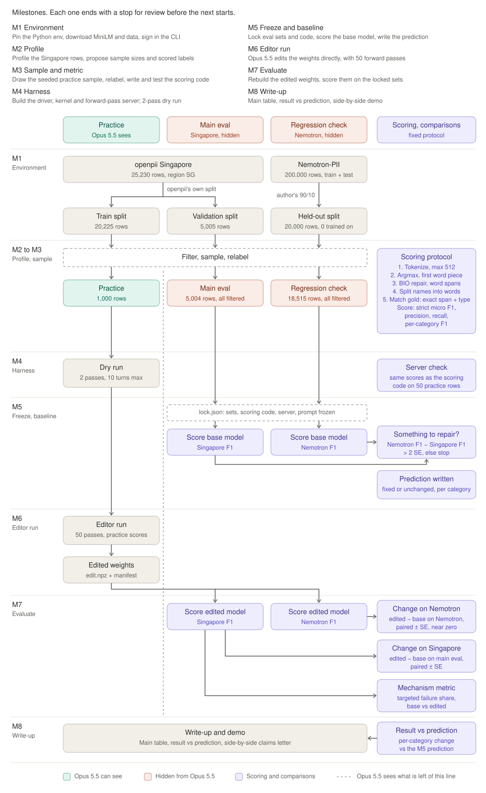
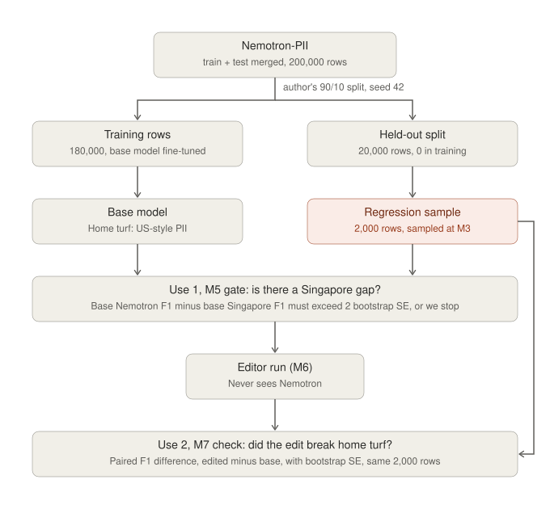

# M1 report: environment

M1 sets up a reproducible base for the experiment in [weight-space-pii-handoff.md](weight-space-pii-handoff.md). It covers four things: a pinned Python environment, the model and data at pinned revisions, a signed-in editor CLI, and a first look at how the base model labels Singapore text.

Status: complete, 2026-11-04. Committed as `e88a142`, merged into `main`.

## The experiment runs in eight milestones



The figure is a swimlane diagram. Rows are milestones, read from top to bottom, and the key at the top says what each milestone does. The first three columns are the data sets. The editor sees the practice set. It never sees the other two, the main eval and the regression set. The fourth column holds the scoring protocol and every comparison the experiment reports. Each comparison sits on the row of the milestone that runs it.

The data is split in two places. First, each source has its own split. openpii has `train` and `validation`, and Nemotron-PII has the model author's 90/10 split. Second, the box labelled "Split point" at M3 filters, samples, and relabels all three sets. The dashed vertical line separates what the editor can see from what it never sees. Only the edit crosses that line, after the editor run ends.

The metric is entity-level strict micro F1, computed by the five-step protocol that M3 fixes. A predicted entity counts only if both its span and its type match the gold annotation. Purple boxes are scoring steps and comparisons, and the figure labels the comparisons C1 to C5:

- M4 checks that the forward-pass server and the scoring code give the same scores.
- M5 scores the base model and applies the C1 gate.
- M7 scores the edited model on the same locked rows for comparisons C2 to C4.
- M8 compares the per-category result with the M5 prediction, which is comparison C5.

Every base-versus-edited comparison is paired. We score both models on the same rows and report the F1 difference with its bootstrap standard error over rows. M3 fixes the exact BIO repair rule.

[docs/figures/e2e_pipeline.py](figures/e2e_pipeline.py) generates the figure. To change the figure, edit that script and rerun it.

## The environment pins 78 packages

The project uses `uv` with Python 3.13.14. [pyproject.toml](../pyproject.toml) pins each direct dependency to an exact version, and [uv.lock](../uv.lock) pins all 78 resolved packages. The direct dependencies are:

| Package | Version |
|---|---|
| torch | 2.15.0 |
| transformers | 5.22.1 |
| datasets | 5.1.0 |
| huggingface-hub | 2.4.0 |
| numpy | 2.5.4 |
| scipy | 1.18.1 |
| scikit-learn | 1.9.1 |
| pandas | 3.1.0 |
| pyarrow | 26.0.1 |
| safetensors | 0.8.0 |
| tokenizers | 0.23.3 |

## The model and data are pinned by revision and hash

[scripts/fetch.py](../scripts/fetch.py) downloads the model and data at pinned revisions. It writes [data/revisions.json](../data/revisions.json), which records each revision, the sha256 of each output file, and the row counts. Git ignores everything under `data/` except `revisions.json`.

| Source | Revision | Output | Rows |
|---|---|---|---|
| `Negative-Star-Innovators/MiniLM-L6-finetuned-pii-detection` | `e43200abcd5e739eddd31f55929f986b2b912b6b` | `data/model/` | Model, no rows |
| `ai4privacy/pii-masking-openpii-1.5m`, `train`, `region == "SG"` | `a785eb528e28be2693c3718a27e066970de5dadb` | `data/raw/openpii_sg_train.jsonl` | 20,225 of 1,309,912 |
| `ai4privacy/pii-masking-openpii-1.5m`, `validation`, `region == "SG"` | `a785eb528e28be2693c3718a27e066970de5dadb` | `data/raw/openpii_sg_validation.jsonl` | 5,005 of 326,463 |
| `nvidia/Nemotron-PII`, the model's held-out split | `b70ffaf5ff39e079776134c5bf4381f00a9fd1ed` | `data/raw/nemotron_heldout.parquet` | 20,000 of 200,000 |

The model config matches the brief. The model is BERT with 6 layers, hidden size 384, 12 attention heads, intermediate size 1,536, vocabulary 30,522, and 111 labels. The 5,005 SG `validation` rows also match the count in the brief.

The output files have these sha256 hashes:

| File | sha256 |
|---|---|
| `data/model/model.safetensors` | `25cac79dc5b9f754b9228292d590440ddb8267252bd5cf13d6bd228b1b945cbd` |
| `data/model/config.json` | `bb0a4533be0b0b6d294387ed144213546e7bcbfef3d24778d6b7462db6558a0e` |
| `data/model/tokenizer.json` | `cb374d6bc042c22455946f4e09a89d29882a199fdaf8fb25be00dc8b8857a448` |
| `data/raw/openpii_sg_train.jsonl` | `e5c69d8443a006e4158d87bb0f94c1e736885b2e60f239de891956b12b084977` |
| `data/raw/openpii_sg_validation.jsonl` | `1e4b06c8f97408da782e80ffa3dccb856de91c6a49f328a20ce458990a067f0c` |
| `data/raw/nemotron_heldout.parquet` | `409daa054eebb03008e6312775dcc1e8bd8190fc47630a0e4563e8e0de2c19fe` |

`revisions.json` also lists the hashes of the other tokenizer and config files.

## The regression check uses the model's held-out split, not Nemotron's `test` split

At first, the brief said to use Nemotron-PII's `test` split for the regression check. It assumed that the model trained only on `train`. That assumption was wrong.

The model trained on Nemotron-PII, and we use Nemotron-PII to check for regressions. The editor never sees it. We use its held-out rows twice. At M5, they confirm that the base model is weaker on Singapore text than on Nemotron. At M7, they check that the edit did not make the model worse on Nemotron. Both checks are valid only if the model never trained on those rows.



The model card links its training code at [Negative-Star-Innovators/local-pii-detector-minilm](https://github.com/Negative-Star-Innovators/local-pii-detector-minilm). The training notebook is [`MiniLM_L6_v2_pii_detector_training_script.ipynb` at commit `61bb78f`](https://github.com/Negative-Star-Innovators/local-pii-detector-minilm/blob/61bb78f0e16f0d2762f8bf63ec5d1ce8e43c378d/MiniLM_L6_v2_pii_detector_training_script.ipynb). That commit, from 2026-02-23, is the only one that touches the notebook. The notebook's second code cell, under the comment `# 2. Load Data`, merges the two splits and splits them again:

```python
train_split = load_dataset(DATASET_NAME, split="train")
test_split = load_dataset(DATASET_NAME, split="test")
raw_datasets = concatenate_datasets([train_split, test_split])
raw_datasets = raw_datasets.train_test_split(test_size=0.1, seed=42)
```

That code produces the "180k Training / 20k Validation split" that the [model card at `e43200a`](https://huggingface.co/Negative-Star-Innovators/MiniLM-L6-finetuned-pii-detection/blob/e43200abcd5e739eddd31f55929f986b2b912b6b/README.md) describes. We rebuilt the split on the pinned revision and compared texts by hash:

| Row set | Rows | Texts also in the model's 180k training rows |
|---|---|---|
| Nemotron `test` split | 100,000 | 89,895 |
| Rebuilt 20k held-out split | 20,000 | 0 |

The held-out split takes 10,105 rows from the original `test` split and 9,895 from `train`. The original `train` and `test` splits share no texts.

`fetch.py` now rebuilds the held-out split with the same `datasets` call and keeps only the held-out part. If any held-out text appears in the training part, `fetch.py` stops with an error. A rebuild from scratch gives the same sha256.

We infer that the rebuilt split matches the author's split exactly, but we cannot prove it, because the author did not publish the split indices. Two facts support the inference:

- The split is deterministic. `datasets` builds it with `np.random.default_rng(42).permutation` over the rows, concatenated in the notebook's order.
- The pinned Nemotron revision was last modified on 2025-12-17. It was the only revision that existed when the author uploaded the model on 2026-03-08.

The brief's §3 regression row and its M1 download bullet now describe the held-out split.

## The editor CLI is signed in and resumes sessions

`claude auth status` reports `"loggedIn": true` with `"authMethod": "claude.ai"` on a Max subscription. We ran a test call with the full editor command from §2 of the brief, from an empty directory outside the project. It returned `OK` from `claude-opus-5-5` without an error:

```bash
claude -p "Reply with the single word OK." --session-id <uuid> --model claude-opus-5-5 --effort max --tools "" --strict-mcp-config --disable-slash-commands --output-format json
```

A second call with `--resume` on the same session ID also returned `OK` and reported the same session ID:

```bash
claude -p "Repeat your previous reply exactly." --resume <uuid> --model claude-opus-5-5 --effort max --tools "" --strict-mcp-config --disable-slash-commands --output-format json
```

## The base model finds NRICs but mistypes them

[scripts/probe.py](../scripts/probe.py) labels three hand-written Singapore sentences. For each word, it takes the argmax label of the word's first subtoken. It then groups each run of `B-` and `I-` labels of one type into an entity. The probe is a sanity check, not the M3 scoring protocol.

| Text | Base model output |
|---|---|
| `Tan Wei Ming` | Three entities: `first_name`, `last_name`, `last_name` |
| `Siti Nurhaliza binte Ahmad` | Four entities: `first_name`, then `last_name` three times |
| `Rajesh s/o Kumaran` | `last_name` on `Rajesh`, then `last_name` on `s/o Kumaran` |
| `S8812345D`, `S7654321A` | `biometric_identifier` |
| `NRIC T0234567J` | `certificate_license_number` on `NRIC`, `health_plan_beneficiary_number` on the ID |
| `+65 9123 4567`, `8765 4321`, `6123 4567`, `+65 8234 5678` | `phone_number`, one correct entity each |

On these three sentences, the model detects each NRIC but gives it the wrong type, and the wrong type varies. It splits each multi-word name into one entity per word. It labels each Singapore phone number as one correct `phone_number` entity. Three sentences are an indication, not a measurement.

## Reproduce M1

To rebuild M1 from a fresh clone, run these commands in order:

1. Install the pinned environment.

	```bash
	uv sync
	```

2. Download the model and data, and write `data/revisions.json`.

	```bash
	uv run python -I scripts/fetch.py
	```

3. Run the probe.

	```bash
	uv run python -I scripts/probe.py
	```

You can rerun `fetch.py` safely. It rehashes existing outputs and does not rewrite them. The first run downloads about 5.6 GB of openpii and Nemotron files into the Hugging Face cache.

## Sources

The table lists every external source that M1 uses, pinned to the revision we used. [docs/sources/](sources/) holds archived copies of the two documents that the Nemotron finding depends on. If either upstream page changes, the evidence stays in this repo.

| Source | Pinned link | Archived copy |
|---|---|---|
| Model training notebook (MIT, Negative Star Innovators) | [`61bb78f`](https://github.com/Negative-Star-Innovators/local-pii-detector-minilm/blob/61bb78f0e16f0d2762f8bf63ec5d1ce8e43c378d/MiniLM_L6_v2_pii_detector_training_script.ipynb) | [MiniLM_L6_v2_pii_detector_training_script.ipynb](sources/MiniLM_L6_v2_pii_detector_training_script.ipynb), git blob `086073e2980aafd8b50d03b426720087e8e9f4b4`, the same as upstream |
| Training repo license | [`866181d`](https://github.com/Negative-Star-Innovators/local-pii-detector-minilm/blob/866181dac0da4c85b1a2f15a74321148f15ea9f4/LICENSE) | [LICENSE-local-pii-detector-minilm](sources/LICENSE-local-pii-detector-minilm) |
| Model card (MIT) | [`e43200a`](https://huggingface.co/Negative-Star-Innovators/MiniLM-L6-finetuned-pii-detection/blob/e43200abcd5e739eddd31f55929f986b2b912b6b/README.md) | [model_card_e43200a.md](sources/model_card_e43200a.md), sha256 `47ce5933…e083e4`, the same as `data/model/README.md` |
| Model weights and tokenizer | [`e43200a`](https://huggingface.co/Negative-Star-Innovators/MiniLM-L6-finetuned-pii-detection/tree/e43200abcd5e739eddd31f55929f986b2b912b6b) | `data/model/`, hashes in `revisions.json` |
| openpii-1.5m (CC-BY-4.0, Ai4Privacy / Ai Suisse SA) | [`a785eb5`](https://huggingface.co/datasets/ai4privacy/pii-masking-openpii-1.5m/tree/a785eb528e28be2693c3718a27e066970de5dadb/data) | `data/raw/openpii_sg_*.jsonl`, hashes in `revisions.json` |
| Nemotron-PII | [`b70ffaf`](https://huggingface.co/datasets/nvidia/Nemotron-PII/tree/b70ffaf5ff39e079776134c5bf4381f00a9fd1ed/data) | `data/raw/nemotron_heldout.parquet`, hash in `revisions.json` |
| `datasets` `train_test_split` | `datasets==5.1.0`, `arrow_dataset.py`, which builds the permutation with `np.random.default_rng(seed)` | Not archived, because `uv.lock` pins the package |

The latest commit in the training repo, `866181d` from 2026-02-24, changes only the README. The notebook is the same at both commits.

## Open items

- The rebuilt Nemotron held-out split matches the author's split by inference, not proof. The [held-out split section](#the-regression-check-uses-the-models-held-out-split-not-nemotrons-test-split) gives the evidence.
- `.venv` and `data/` are local, and git ignores them, apart from `data/revisions.json`. `fetch.py` rebuilds `data/`.
