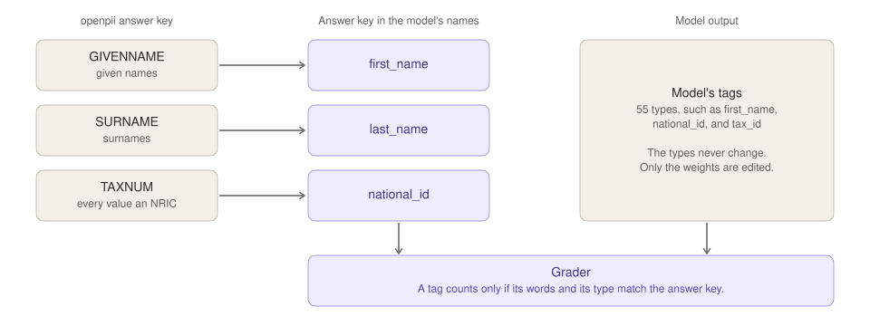
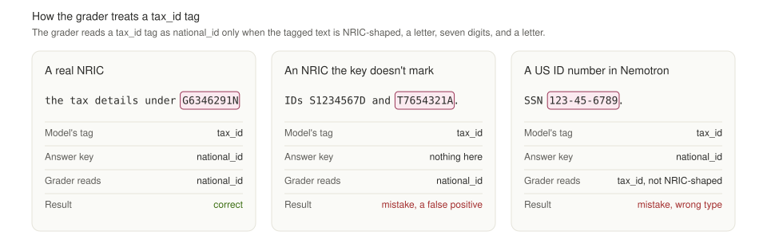

# M3 report: sample, relabel, define the metric, and review samples

M3 builds the three sets the experiment uses, writes the scoring code, tests it on hand-built cases, and renders 12 rows for review. It follows §5 and §7 of [weight-space-pii-handoff.md](weight-space-pii-handoff.md), with the scope that the [M2 report](m2_report.md) fixed.

Status: complete, 2026-11-04. Desmond reviewed the gold labels and the label map and made the decisions below. Committed as `0a4019f` on `main`.

## How the model, the data, and the grader fit together

M3 grades the model by comparing its tags with openpii's answer key. Each step below depends on the one before it.

1. **The model tags words.** `MiniLM-L6-finetuned-pii-detection` is a small BERT-style network. It reads a text and gives each word one tag. The tag is either "not personal information" or one of 55 types, such as `first_name`, `phone_number`, `national_id`, and `tax_id`. The model does not write a masked text. Masking is a separate step that replaces each tagged word with a placeholder, and this experiment never runs it.
2. **The model learned from American data.** Its training data is Nemotron-PII, which uses made-up US personas. In that data, `national_id` and `tax_id` are different numbers. The word before the number, "national" or "tax", tells them apart. The training data holds 64 NRIC-shaped numbers, and almost all of them follow the word "national".
3. **The Singapore data has its own answer key.** The Singapore rows come from openpii. Each row marks its personal information with openpii's own type names, such as `GIVENNAME`, `SURNAME`, and `TAXNUM`.
4. **We translate the answer key, not the model.** To grade the model, we rewrite openpii's types in the model's names. `GIVENNAME` becomes `first_name`, `SURNAME` becomes `last_name`, and `TAXNUM` becomes `national_id`. The model's 55 tag types never change. The editor may change only the weights, and everything else stays fixed, so a change in score can come only from an edit.
5. **openpii files NRICs as tax numbers.** Every `TAXNUM` value is an NRIC, such as `G6346291N`, and no other openpii type holds one. In Singapore, the NRIC is also the tax reference number. So openpii's sentences read like "review the tax details under G6346291N". In this experiment, `national_id` means NRIC.
6. **The model often calls an NRIC `tax_id`.** The model sees the word "tax" and answers `tax_id`. That answer agrees with the sentence, but the answer key says `national_id`. The grader is strict. A tag counts only if its words and its type both match the answer key.
7. **The grader accepts `tax_id` for NRICs, and only for NRICs.** Desmond decided to accept either type. The grader treats a `tax_id` tag on an NRIC-shaped value, a letter, seven digits, and a letter, as a `national_id` tag. That tag is correct where the answer key has an NRIC, and it is a mistake anywhere else. A `tax_id` tag on any other value gets no credit. So in the Nemotron check, a `tax_id` tag on an American ID number still counts as wrong.
8. **No wrong answer is free.** In M4 to M6, an AI editor changes the weights to raise this score. If a wrong answer costs nothing, the editor can make the model guess more often. The score would keep the correct guesses and ignore the wrong ones. So step 7 gives a `tax_id` tag on an NRIC-shaped value the same cost as a `national_id` tag, and gives a `tax_id` tag on any other value no credit.



The first figure shows which way the translation in step 4 goes. openpii's labels move to the model's names, and the model's tags stay as they are.



The second figure shows the three cases of step 7. [docs/figures/report_figures.py](figures/report_figures.py) generates both figures.

One question stays open. The model fails on NRICs that have no ID word before them. It may have learned the NRIC shape weakly, or only together with the word "national". The experiment tests that hypothesis. It is not a finding yet.

## Decisions

Desmond made these decisions on 2026-11-04. They override the brief and the M2 report where the documents differ.

| Item | Before M3 | Decision |
|---|---|---|
| Multi-word names | M2 said M3 would move no gold span boundary | Scoring splits every `first_name` and `last_name` entity into one entity per whitespace-separated word, on both the gold side and the predicted side, before strict matching. `national_id` is never split |
| Review rows | The brief says to ask | 12 rows: 6 practice rows and 6 main-eval rows |
| NRIC type | M2 accepted only `national_id` | A predicted `tax_id` on an NRIC-shaped value is scored as `national_id`. It counts as correct on a gold NRIC and as a false positive anywhere else. A `tax_id` on any other value gets no credit. The rule is off when `tax_id` is itself scored, so the all-label regression check on Nemotron stays strict |
| Other ID numbers | M2 dropped `IDCARDNUM`, `PASSPORTNUM`, `DRIVERLICENSENUM`, and `SOCIALNUM` | Their spans become ignore spans. A scored prediction that overlaps an ignore span and matches no gold entity counts neither as right nor as wrong |

The set files keep openpii's span boundaries. The split happens only inside `wsp.score.grade`, so the rule lives in one place. The M4 forward-pass server and the M5 and M7 scoring all use that function.

### Why names are split into words

On the first 1,500 `validation` rows, the base model labelled 254 of 419 two-word given names as `first_name` followed by `last_name`. It labelled 177 of 374 two-word surnames as one `last_name` entity per word. Across those rows, it predicted `I-first_name` on 72 words and `B-first_name` on 1,291 words. The model learned from Nemotron, where 0.3% of `first_name` spans and 1.1% of `last_name` spans have more than one word, so it almost never joins name words into one entity.

Under strict spans, almost every multi-word name would score as wrong, whatever type the model gave each word. An editor could then raise F1 by teaching the model openpii's B-I convention instead of by finding more names. Splitting both sides removes that convention from the score. It keeps the type error that matters: a second given name typed as `last_name` still counts as wrong.

## Sets

[scripts/build_sets.py](../scripts/build_sets.py) builds the sets in about 3 s and writes them to `data/sets/`. Every row is one JSON object with `id`, `text`, `spans`, and `ignore`. Each entry in `spans` has `start`, `end`, and `label` in the model's label names. Each entry in `ignore` has `start`, `end`, and the openpii label of a dropped ID span. Nemotron rows have no ignore spans. The main eval has 4,050 ignore spans and practice has 785. The practice file name, `sg_train.jsonl`, matches the path in the editor's task prompt.

The script also writes [data/sets.json](../data/sets.json), which git tracks like `data/revisions.json`. It records the seed, the row count after each filter, the label map, the gold counts, the Nemotron label check, and the sha256 of each set file. Two runs gave the same hashes.

### Row count after each filter

The practice sample uses seed `20261104`. Neither evaluation set is sampled.

| Step | Practice, from `train` | Main eval, from `validation` | Regression check, Nemotron held-out |
|---|---|---|---|
| Raw rows | 20,225 | 5,005 | 20,000 |
| 512 tokens or fewer | 20,223 | 5,005 | 18,515 |
| Duplicate texts dropped | 20,216 | 5,004 | 18,515 |
| Text or `masked_text` also in `validation` dropped | 20,211 | Not applied | Not applied |
| Sampled | 1,000 | Not sampled | Not sampled |
| File | `sg_train.jsonl` | `sg_eval.jsonl` | `nemotron_eval.jsonl` |

The token count includes special tokens, as in M2. The script asserts that the practice set and the main eval share no text.

### Full label map

The openpii sets keep three labels and drop every other span. Nemotron keeps all of its spans, because its labels are already the model's labels.

| openpii label | Model label | Scored on |
|---|---|---|
| `GIVENNAME` | `first_name` | Singapore sets, M5 gate on Nemotron |
| `SURNAME` | `last_name` | Singapore sets, M5 gate on Nemotron |
| `TAXNUM` | `national_id`, with `tax_id` also accepted | Singapore sets, M5 gate on Nemotron |
| All other labels | Dropped | Not scored |

The M7 regression check scores all 55 model labels on Nemotron.

### Gold counts

A scored entity is one gold entity after the name split. The split adds entities only for multi-word names.

| Set | Gold spans | Scored entities | `first_name` | `last_name` | `national_id` |
|---|---|---|---|---|---|
| Practice | 1,963 | 2,589 | 1,255 | 1,114 | 220 |
| Main eval | 9,806 | 12,974 | 6,244 | 5,696 | 1,034 |
| Nemotron, three labels | 23,761 | 23,943 | 13,572 | 9,821 | 550 |
| Nemotron, all labels | 146,769 | 146,951 | 13,572 | 9,821 | 550 |

The span counts match the M2 report exactly.

### Nemotron's labels match the model's labels

Nemotron's held-out rows use 55 span labels. The model has 55 entity types. The two sets are identical, with no label missing on either side, so the regression check scores every label without a map. `build_sets.py` stops with an error if the sets ever differ.

### Few gold spans fall inside a tokenizer word

Predicted entities start and end on tokenizer word boundaries, so a gold span that starts or ends inside a word can never match exactly.

- In the main eval, 18 of 9,806 gold spans fall inside a word. Most follow a literal `\n` in the text, which the tokenizer joins to the next word, as in `\nMéganne`.
- In the first 4,000 Nemotron rows, 87 of 33,629 gold spans, or 0.26%, fall inside a word. Most are `occupation` spans such as `Broker` inside `Brokerage`.

Both counts are too small to change a result. These entities stay in the gold set and count as missed for both models.

## Scoring protocol

The protocol lives in [src/wsp/score.py](../src/wsp/score.py) and [src/wsp/predict.py](../src/wsp/predict.py):

1. Tokenize with the model's tokenizer, truncated at 512 tokens.
2. Take the argmax label of each token. A word takes the label of its first subtoken.
3. Repair BIO tags. An `I-X` tag continues an entity only after `B-X` or `I-X`. Otherwise it starts a new entity. Each entity spans from the start of its first word to the end of its last word.
4. Split every `first_name` and `last_name` entity into one entity per whitespace-separated word, on both the gold and the predicted side.
5. Score each predicted `tax_id` on an NRIC-shaped value as `national_id`, unless `tax_id` is itself scored. `wsp.score.scored_label` holds this rule.
6. Drop each scored prediction that overlaps an ignore span and matches no gold entity.
7. Count an entity as correct only if its span and its type both match a gold entity exactly. Report strict micro F1, precision, and recall, overall and per label.

The scorer also sorts each unmatched gold entity into one failure kind for the forward-pass tool:

| Failure | Rule |
|---|---|
| `wrong_type` | A prediction has the gold entity's exact span but another label |
| `wrong_boundary` | No prediction has the exact span, but one overlaps it |
| `missed` | No prediction overlaps the gold entity |
| `false_positive` | A prediction with a scored label overlaps no gold entity with a scored label |

A prediction with an unscored label is never a false positive. It can still make a gold entity `wrong_type` or `wrong_boundary`. For example, an NRIC predicted as `biometric_identifier` counts as `wrong_type`.

`wsp.score.bootstrap` gives the bootstrap standard error of micro F1 over documents. Given two models' grades on the same documents, it also gives the paired difference with its standard error. M5 and M7 use it.

To make `wsp` importable under `python -I`, `pyproject.toml` now has a `uv_build` build system, and `uv sync` installs the package. The pinned dependencies did not change, and `uv.lock` changed by one line.

### Metric tests

[tests/test_score.py](../tests/test_score.py) holds 29 tests, and all of them pass:

```bash
uv run python -I -m unittest discover -s tests
```

| Case | Gold | Prediction | Result |
|---|---|---|---|
| Exact match | NRIC `S1234567D` as `national_id` | Same span and type | 1 true positive |
| Wrong type, unscored label | NRIC as `national_id` | NRIC as `biometric_identifier` | 1 false negative, `wrong_type` |
| Wrong type, scored label | `Tan` as `last_name` | `Tan` as `first_name` | 1 false positive, 1 false negative, `wrong_type` |
| Boundary off by one word | NRIC as `national_id` | `is S1234567D` as `national_id` | 1 false positive, 1 false negative, `wrong_boundary` |
| Missed entity | NRIC as `national_id` | Nothing | 1 false negative, `missed` |
| False positive | NRIC as `national_id` | NRIC, plus `Dear` as `first_name` | 1 true positive, 1 false positive |

The other tests cover the name split, BIO repair, the bootstrap, and the real model. The split tests check that a multi-word gold name counts once per word, and that one predicted span over `Wei Ming` scores the same as one span per word. The bootstrap test compares the standard error with a jackknife estimate. The real-model tests check that a word takes the tag of its first subtoken, that a batch of texts gives the same entities as one text at a time, and that predicted entities start and end on word edges.

### Independent review

A separate reviewer agent read the code and ran its own checks. It found no correctness defect. Its checks:

- Predictions were identical at batch sizes 1 and 32 on 200 practice rows and 100 Nemotron rows.
- Character offsets were right on non-ASCII text, including accented names, Chinese characters, and a non-breaking space.
- The bootstrap standard error on the main eval was 0.00425, against a jackknife estimate of 0.00424.
- A rebuild of the sets gave byte-identical files.

The reviewer found three gaps, which M3 fixed:

1. Four of 13 code mutations passed the tests: taking the last subtoken's tag, mixing up rows in a batch (two variants), and dividing the bootstrap standard error by 10. Four new tests now catch them, and all 13 mutations fail the suite.
2. On Nemotron, a scored prediction over a gold span of an unscored label fell into no failure kind. It now counts as `false_positive`. The Singapore sets hold only scored gold labels, so their counts do not change.
3. The bootstrap held every resample in memory at once, which peaked at 3.3 GB on Nemotron. It now draws resamples in blocks of 100.

A second review, by Codex, found two problems in the first version of the `tax_id` rule. M3 fixed both, and the report now states the training-data explanation as a hypothesis:

1. The rule credited a `tax_id` only where it matched a gold NRIC and discarded every other `tax_id`. One correct NRIC plus one false alarm therefore scored F1 1.0 as `tax_id` but 0.67 as `national_id`. The rule now scores every `tax_id` on an NRIC-shaped value as `national_id`, so false alarms count.
2. The rule credited `tax_id` on any gold `national_id`, including Nemotron's non-NRIC values such as `123-45-6789`, which would have loosened the M5 gate. The rule now applies only to NRIC-shaped values.

Both fixes leave the practice scores and the review rows unchanged, because the base model makes neither error on practice. Two new tests reproduce Codex's cases.

## Review rows

[docs/m3_review.md](m3_review.md) renders the 12 review rows, generated by [scripts/review.py](../scripts/review.py). Rows 1 to 6 come from the practice set and rows 7 to 12 from the main eval. Each half covers one-word and multi-word given names, one-word and multi-word surnames, and NRICs.

For each scored entity, the file gives the label we expect from the base model and the label it produced. The expected label is the most common base-model outcome for that kind of entity on the other 994 practice rows:

| Kind of entity | Entities on practice rows | Expected base output | Share |
|---|---|---|---|
| One-word given name | 673 | `first_name` | 62% |
| Multi-word given name, first word | 287 | `first_name` | 68% |
| Multi-word given name, later word | 287 | `last_name` | 87% |
| One-word surname | 529 | `last_name` | 91% |
| Multi-word surname, first word | 242 | `last_name` | 83% |
| Multi-word surname, later word | 333 | `last_name` | 84% |
| NRIC | 216 | `tax_id` | 60% |

On the 12 rows, the base model gets 29 of 41 scored entities right.

## What the review rows show

These findings come from the practice set and from text statistics. They are not the M5 baseline, which scores the frozen sets.

### The model reads most NRICs as `tax_id`, and the text supports that reading

On the practice set, the base model labels no NRIC as `national_id`. It gets 0 of 220, so before the decision below, `national_id` F1 on practice was 0.0. Its most common label for an NRIC is `tax_id`.

The text explains the choice. openpii's generator fills `TAXNUM` slots with NRICs, so it writes the context around them as tax context. In the main eval, 711 of 1,034 NRICs (69%) have the word "tax" within the 60 characters before them, as in "your tax identifier M6750544C". Only 24 (2%) have "NRIC" or "IC" there. When the model answers `tax_id`, it follows the sentence. The M2 map calls these values `national_id` because of their shape.

This matters for the brief's hypothesis. The brief reads the NRIC result as an obstacle: the model detects NRICs but types them wrongly. On this data, most of the "wrong" type agrees with the text. Scoring only `national_id` as correct would reward an edit for overriding the words around the number with the NRIC shape.

### The training data is consistent with a context-word rule

The training data suggests that the model picks an ID label from the words before the number. Nemotron's held-out rows come from the same data as the model's training rows:

| Nemotron label | Spans | NRIC-shaped values | "national" in the 60 characters before | "tax" in the 60 characters before | Common value shapes |
|---|---|---|---|---|---|
| `national_id` | 550 | 5 | 525 | 0 | `999-99-9999`, long digit strings |
| `tax_id` | 343 | 1 | 0 | 333 | `999-99-9999`, `99-9999999` |
| `biometric_identifier` | 1,972 | 0 | 9 | 1 | `BIO-7426598130`, `H73942561890` |
| `health_plan_beneficiary_number` | 1,587 | 0 | 2 | 0 | `AET-7283-1594-37`, `G123456789A` |

In this data, a number after the word "national" is a `national_id`, and a number after "tax" is a `tax_id`. The value shapes overlap, so only the context word separates the two labels. Other letter-and-digit shapes, such as `H73942561890` and `G123456789A`, belong to `biometric_identifier` and `health_plan_beneficiary_number`. In the M1 probe, `NRIC T0234567J` came out as `health_plan_beneficiary_number`.

The model did see NRIC shapes in training. We rebuilt the model's 180,000 training rows with the split in `fetch.py`. They hold 64 NRIC-shaped spans in 59 rows, and 61 of the spans fall inside the 512-token limit. 55 are labelled `national_id` and 9 `tax_id`. 54 of the 64 follow the word "national". So the training data paired NRIC shapes with an explicit context word almost every time, and rarely showed one on its own.

The NRIC case therefore has two parts. Where the text says "tax", the model's `tax_id` answer agrees with the text. Where the text gives no ID word, the model gets the type wrong. One explanation is that the model learned the NRIC shape weakly or only together with the word "national". That is a hypothesis. Seeing 61 examples does not prove the model learned the shape, and failing on no-context NRICs does not prove it lacks the shape. The editor's causal tests, or our own after M7, have to settle it.

Desmond decided to accept `tax_id` as well as `national_id` for an NRIC. Under that rule, the practice NRICs split cleanly by context:

| NRIC context on practice | NRICs | Right | Share right |
|---|---|---|---|
| "tax" in the 60 characters before | 159 | 134 | 84% |
| No "tax" there | 61 | 0 | 0% |

Of the 86 NRICs the model still gets wrong, 42 come out as `biometric_identifier`, 22 are missed, and the rest scatter across 11 other ID types and boundary errors. The no-tax group holds the failure an edit would most need to fix. It is a candidate for the M7 mechanism metric.

### The model's `national_id` predictions land on IDs that M2 dropped

On practice, the model makes 65 `national_id` predictions that match no gold entity. 45 of them sit on `IDCARDNUM` values, which M2 dropped from the map, 8 on `PASSPORTNUM`, and 6 on `DRIVERLICENSENUM`. Row 8 of the review shows the case: `National ID: JJ41UFO2L4` is an `IDCARDNUM` span. Counted as false positives, these predictions would give the editor a reason to suppress `national_id` on ID card numbers. Desmond decided to ignore them, so the scorer now drops them. On practice, `national_id` false positives fall from 65 to 5.

### Other gold-label quirks

- **Placeholder leaks.** 71 of 5,004 main-eval rows (1.4%) and 6 of 1,000 practice rows hold template text such as `[GIVENNAMEPLACEHOLDER_21]` that the generator did not fill. Review row 9 shows one. The placeholder carries no gold span. M3 keeps these rows, because the brief uses the data as it is.
- **Arguable name types.** Review row 12 marks `Iluminada Roane` as one given name, and row 2 marks `Dragos-Costin Keyfo` as one given name. A reader could call `Roane` and `Keyfo` surnames. The generator chose the types, and the scorer follows them.

## Practice-set score of the base model

These numbers describe the practice set only. The editor sees this set, and the M5 baseline replaces these numbers for any claim.

| Label | F1 | Precision | Recall |
|---|---|---|---|
| `first_name` | 0.590 | 0.710 | 0.504 |
| `last_name` | 0.749 | 0.657 | 0.872 |
| `national_id` | 0.746 | 0.964 | 0.609 |
| Overall | 0.682 | 0.693 | 0.671 |

The biggest failure kind is `wrong_type`, at 604 of the 1,077 failures. Most of these are later words of given names typed as `last_name` (472 words).

## Reproduce M3

Run these commands from the repository root:

1. Install the environment, which now includes the `wsp` package.

	```bash
	uv sync
	```

2. Build the sets and `data/sets.json`.

	```bash
	uv run python -I scripts/build_sets.py
	```

3. Run the metric tests.

	```bash
	uv run python -I -m unittest discover -s tests
	```

4. Render the review rows.

	```bash
	uv run python -I scripts/review.py
	```

5. Regenerate the pipeline figure, which now shows the M2 set sizes and the name split.

	```bash
	uv run python -I docs/figures/e2e_pipeline.py
	```

## Open items

M3 has no open decisions. Two items carry into M4:

- The editor's task prompt must describe the name split, the ignore spans, and the `tax_id` rule, because the practice rows and the forward-pass grades use all three.
- The forward-pass server must grade through `wsp.score.grade`, so that it applies the same rules as M5 and M7.
