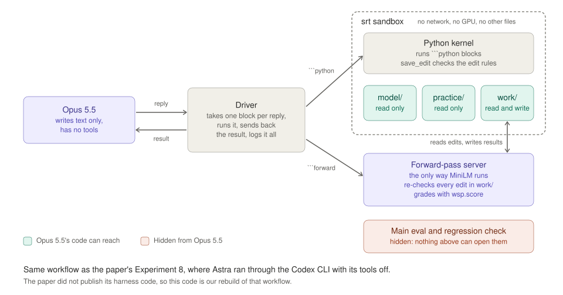
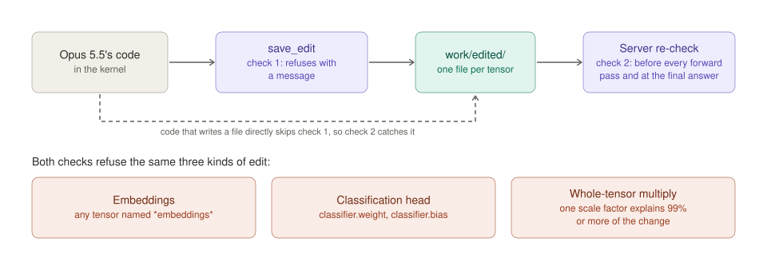

# M4 report: harness and dry run

M4 builds the harness that Opus 5.5 works through when it edits MiniLM, and tests it end to end. The harness has five parts: a sandboxed Python kernel, the `save_edit` refusals, a forward-pass server, the driver around the `claude` CLI, and per-run logging. It follows §2 and §7 of [weight-space-pii-handoff.md](weight-space-pii-handoff.md), with the decisions in the [M3 report](m3_report.md).

Status: complete, 2026-11-05. Desmond reviewed the items under "Show me" and made the decisions below. Committed as `b0fde38` on `main`.

## What you need to know first

The brief and three earlier reports hold the background. This section restates what M4 depends on. Each step builds on the one before it.

1. **Two AI models take part.** MiniLM (`MiniLM-L6-finetuned-pii-detection`) is the small model being edited. It tags each word of a text as a type of personal information, such as `first_name` or `national_id`, or as nothing. Opus 5.5 does the editing. It reads MiniLM's weights, runs experiments, and changes numbers inside MiniLM. The brief calls Opus 5.5 "the editor".
2. **The question is whether direct weight edits help.** MiniLM learned from American data and makes mistakes on Singapore text. Opus 5.5 gets no training tools. It has to find what goes wrong inside MiniLM and change the weights by hand. The paper this experiment copies edited a different model, Qwen3.5-0.8B, at math. It found that such edits can remove an obstacle that hides an ability the model already has, but cannot add a missing one. This experiment asks whether the same holds for MiniLM on Singapore text.
3. **M1 to M3 settled the data and the score.** M1 pinned the environment. M2 chose three sets. Opus 5.5 sees only the 1,000-row practice set. The 5,004-row main eval and the 18,515-row regression check stay hidden until M5 and M7. M3 set the scoring rules: names are scored word by word, a `tax_id` tag on an NRIC counts as `national_id`, and tags on unscored ID numbers count neither way. `wsp.score.grade` applies these rules everywhere.
4. **Opus 5.5 can only write text.** It runs through `claude -p` with every tool switched off. The paper ran its editing model, Astra, the same way, through the Codex CLI with its tools off. Each reply holds exactly one ` ```python ` block, one ` ```forward ` block, or, at the end, no block. The harness reads the block, runs it, and sends back the result as the next message. A run is a long conversation of this kind.
5. **A ` ```python ` block runs in a sandboxed kernel.** The kernel is one persistent Python process, like a notebook, so variables survive between blocks. It can read MiniLM's weights and the practice set, and write a `work/` folder. It cannot open the hidden sets, reach the network, or use the GPU. Anthropic's sandbox runtime, `srt`, enforces these limits. `srt` is the engine behind Claude Code's own sandbox. Opus 5.5 may run up to 300 blocks.
6. **A ` ```forward ` block is the only way MiniLM runs.** The forward-pass server runs MiniLM, with or without Opus 5.5's edits, on practice items and on texts Opus 5.5 writes. It grades the practice items with `wsp.score.grade`, the same function M5 and M7 use for the final score. It can also return MiniLM's internal activations. Each request costs one forward pass from a budget of 50.
7. **Three kinds of edit are out of scope.** Opus 5.5's code saves an edit with `save_edit`. `save_edit` refuses edits to the embeddings, edits to the classification head, and edits that only or almost only multiply a whole tensor by one number. The server checks every edit file again, because code could write a file without `save_edit`.
8. **The run ends with a final answer.** When the budget is spent, Opus 5.5 explains what it changed and why. The harness then submits the edits in `work/edited/`. M7 scores the edited MiniLM on the hidden sets.
9. **M4's job is to build this and prove each part works.** M5 freezes the harness by hash before the real run, so a bug left in it would affect every result the experiment reports.



The first figure shows one run. Opus 5.5, on the left, writes replies. The driver, in the middle, sends ` ```python ` blocks into the sandbox, the dashed box, and ` ```forward ` blocks to the server below it. Inside the sandbox, Opus 5.5's code can reach only the green folders. The server sits outside the sandbox because it needs MiniLM and the scorer. It reads the edits from `work/` and writes its results back there. Nothing in the figure can open the hidden sets at the bottom right. The note at the bottom says where the design comes from. The loop is the paper's Experiment 8 workflow, and the message formats copy the paper's logs word for word. The paper published its prompts and logs but not its harness code, so the code is ours. Two parts of the paper's workflow are not built yet: restarting the conversation every 40 turns, and sending back a code block that comes without a plain-English explanation.



The second figure shows where the edit rules apply. An edit passes `save_edit` first and the server's re-check second. The dashed arrow shows why the second check exists. Code that writes into `work/edited/` directly skips the first one. [docs/figures/report_figures.py](figures/report_figures.py) generates both figures.

## Four parts run together

The harness has four parts:

1. **The driver** talks to Opus 5.5 through the `claude` CLI. It retries a failed call on the same session and never counts a failed call as a turn.
2. **The kernel** runs Opus 5.5's Python inside `srt` and enforces the 900-second and 10,000-character limits.
3. **The forward-pass server** runs MiniLM in the driver's process, outside the sandbox.
4. **The run folder** holds the full transcript, every forward request and result, the submitted edit as an exact diff, the final answer, and `run.json`.

| File | Role |
|---|---|
| [src/wsp/harness/box.py](../src/wsp/harness/box.py) | The box that Opus 5.5's code can see (`model/`, `practice/`, `work/`), and the run folder |
| [src/wsp/harness/kernel.py](../src/wsp/harness/kernel.py) | The kernel process and the refusal table. It has no `wsp` imports, because it is copied into the box and run there |
| [src/wsp/harness/kernel_host.py](../src/wsp/harness/kernel_host.py) | Starts the kernel under `srt`, enforces the 900-second and 10,000-character limits, and restarts the kernel on a timeout or a garbled reply |
| [src/wsp/harness/server.py](../src/wsp/harness/server.py) | Request parsing, edit re-checks, predictions, grades, arrays, and the summary |
| [src/wsp/harness/edit.py](../src/wsp/harness/edit.py) | Reads edits without following links, and writes and rebuilds `edit.npz` and `manifest.json` |
| [src/wsp/harness/driver.py](../src/wsp/harness/driver.py) | Reply parsing, the CLI wrapper with retries, the loop, and the logs |
| [src/wsp/harness/prompt.py](../src/wsp/harness/prompt.py), [task_prompt.txt](../src/wsp/harness/task_prompt.txt) | The §6 prompt and the code that fills it in |
| [scripts/run_editor.py](../scripts/run_editor.py) | Starts a run |
| [scripts/m4_checks.py](../scripts/m4_checks.py) | Refusal tests and the server-against-scorer check |
| [scripts/export_transcript.py](../scripts/export_transcript.py) | Renders a transcript as Markdown |
| [tests/test_harness.py](../tests/test_harness.py) | 63 harness tests. The suite now has 92 tests in all |

## Decisions

These choices differ from the brief or fill a gap in it. Desmond chose `srt` on 2026-11-05. Every other row is a default I chose, and Desmond can reverse it.

| Item | Brief | Decision and reason |
|---|---|---|
| Command that runs Opus 5.5 | The `claude -p` line in §2 | Three additions: `--setting-sources ""`, `--system-prompt "Answer the user's request."`, and `CLAUDE_CODE_DISABLE_AUTO_MEMORY=1`. A probe with the brief's command alone showed that the pstack SessionStart hook and the Explanatory output style from the user settings reached Opus 5.5. The replacement system prompt matches the paper's Codex instructions file |
| Sandbox | "Docker isn't needed" | The kernel runs under `srt` (`@anthropic-ai/sandbox-runtime@0.0.81`, run through `npx`), the engine behind Claude Code's sandbox. `srt` starts from a deny-all macOS Seatbelt profile, so routes nobody listed stay closed. The harness supplies only `srt`'s config: the paths the kernel may read and write. An earlier hand-written profile, and `chmod`-based read-only copies, were removed because `srt` covers both |
| Constant-multiple rule | "Any edit that only multiplies a whole tensor by a constant" | Desmond decided on 2026-11-05 to tighten it, in the code and in the prompt. `save_edit` and the server now refuse an edit when one scale factor applied to the whole tensor accounts for 99% or more of the change. The exact rule let a disguised rescale through. It accepted 2 × the tensor with one entry nudged. On real MiniLM tensors, disguised rescales score above 99.9% and "2 × every row but one" scores 99.75% to 99.94%. Targeted edits score at most 58%: zeroing a head's 64 columns, scaling 64 columns, removing one direction, changing one entry. The prompt now says "only, or almost only" and gives the 99% test, so Opus 5.5 is held to the rule it reads. This is the one place our rule's wording differs from the paper's |
| Paths in the prompt | `/model`, `/practice`, `/work` | Real paths, `~/wsp-sandbox/<run>/{model,practice,work}`, because macOS does not allow new folders at `/` |
| Kernel protocol | Not specified | One JSON line each way on the kernel's stdin and stdout. At start-up the kernel moves the protocol off fds 0 and 1, so code that prints cannot corrupt it. Each request carries a random nonce that the reply must echo. A garbled reply restarts the kernel |
| Task prompt | §6 template | Filled in from the model config and the weights. Three additions follow the M3 report: the word-by-word name rule, the `tax_id` rule for NRICs (letters S, T, F, G or M, seven digits, a letter), and the ignored ID numbers with their `ignore` field in the practice file. It also states the layer ranges for `mlp_act` and `attention` |
| Dry-run turn cap | At most 10 turns | The first dry run kept the 10-turn cap. Opus 5.5 used all 10 turns on Python analysis and never made a forward pass. The second dry run, on the final harness, raised the cap to 30 so Opus 5.5 could reach the forward-pass path. The real run has no turn cap |
| Forward arrays | `.npy` files with `meta.json` | Token arrays are concatenated over texts as `[tokens, width]`. `meta.json` gives each text's rows, tokens, and word ids. Attention is saved per text as `[12, T, T]` |

## The filled-in prompt

[docs/m4_task_prompt.txt](m4_task_prompt.txt) is the first message of the second dry run, with one later change, the tightened constant-multiple sentence. For the real run, only the budget (50 instead of 2) and the box name in the paths change.

## Refusal tests

[scripts/m4_checks.py](../scripts/m4_checks.py) runs one test edit per refused case through `save_edit` in the real sandboxed kernel. Every case gave the expected result:

| Edit | Result |
|---|---|
| `bert.embeddings.word_embeddings.weight` + 1 | Refused: embeddings |
| `classifier.weight` + 1 | Refused: classification head |
| 1.1 × a whole MLP weight | Refused: whole-tensor constant multiple |
| 2 × a whole MLP weight, one entry nudged by 0.001 | Refused: almost only a constant multiple |
| A tensor saved unchanged | Refused: unchanged from the original |
| Wrong shape, a NaN, an unknown name | Refused, one message each |
| One entry of an MLP weight changed | Accepted |

Opus 5.5's code shares a process with `save_edit`, so it could write a `.npy` file straight into `work/edited/`. The server therefore re-checks every edit file before each forward pass and before the final submission. `m4_checks.py` writes a 2 × whole-tensor edit straight into `work/edited/`, skipping `save_edit`, and the server refuses it with the same message.

## The server agrees with the scorer

On 50 practice items drawn with seed 20261105, the server's results equal an independent run of `predict`, `grade`, and `summarize` on the project's own model files. The spans, every per-item count and the summary all match exactly. With `"model": "both"` and no edits, the paired difference is 0.0 with a standard error of 0.0. The overall F1 on these 50 items is 0.730.

A request for every array kind on 3 items and 1 text produced the documented files and shapes. Each text's `label_probs` rows match a separate unpadded forward pass to within 1e-5.

## The sandbox blocks every escape we tested

Each row below is a test in `tests/test_harness.py` that runs code in the sandboxed kernel:

| Attempt from the kernel | Result |
|---|---|
| Read `data/sets/sg_eval.jsonl` or the brief, directly, through `/System/Volumes/Data`, or with `cat` | Denied |
| Hard-link a protected file into `work/` | Denied |
| Write to the box root, the model copy, the project, or `/private/tmp` | Denied |
| Connect to 1.1.1.1 or to a localhost port | Denied |
| Run work outside the sandbox through `launchctl submit` | Denied, no job registered. The same command outside the sandbox creates the job |
| Send an Apple Event with `osascript`, or launch an app with `open` | Denied |
| Use the GPU through MPS | Unavailable |
| Read the model and practice files, write `work/`, import torch and the other libraries, run a CPU workload | Allowed |

## An independent review found eight issues

A separate reviewer read the harness before the second dry run. It reproduced the first three issues. Each fix has a regression test. The agent that wrote fixes 1 to 6 reports a mutation run that swapped the old logic back in. The tests caught all 17 mutations. That run predates the `srt` change, and I have not repeated it.

| # | Finding | Fix |
|---|---|---|
| 1 | The server, which runs with full user rights, wrote through symlinks that Opus 5.5's code could plant in `work/` | The server writes into a staging folder the sandbox cannot reach, then renames the result into `work/`. The driver logs from memory and never reads `work/` back |
| 2 | Reads of `work/edited/` followed links, and a bad file crashed the run. numpy's error message could echo the start of a protected file | Each file is opened with `O_NOFOLLOW`. Anything that is not a regular file with one link is refused, and so is any load failure. The message never includes file contents |
| 3 | An unexpected server error ended the run without writing `run.json` | It becomes a failed forward, which costs no pass. `final_answer.md` and `run.json` are always written |
| 4 | Opus 5.5's code could forge kernel replies, which shifted every later output by one | Random nonces, and any garbled reply restarts the kernel |
| 5 | `run.json` summed the CLI's running cost total. The first dry run showed $4.80, but it cost $0.91 | Per-call cost is the change in the running total |
| 6 | `--max-turns` was required, and one message repeated a sentence | Now optional, and the sentence appears once |
| 7 | The hand-written sandbox allowed everything by default | Replaced by `srt` |
| 8 | Rescaling a whole tensor and nudging one entry passes the constant-multiple rule | The rule refuses near multiples too. See "Decisions". A test on real tensors fails under the old exact rule and passes under the new one |

## Dry runs

| | Dry run 1 | Dry run 2 |
|---|---|---|
| Harness | Hand-written sandbox, before the review fixes | Final harness, `srt` |
| Budget and turn cap | 2 passes, 10 turns | 2 passes, 30 turns |
| Turns, Python runs, forward passes | 10, 9, 0 | 30, 28, 1 |
| Failed forwards, invalid replies, kernel restarts | 0, 0, 0 | 0, 0, 0 |
| Wall time | 6 minutes | 18 minutes |
| Cost | $0.91 | $3.06 |
| Edits | None | None |

Both runs ended at the turn cap. Opus 5.5 had spent its turns on diagnosis, so it made no edit. `work/edited/` was empty at the end of both runs, so there was nothing to delete.

In dry run 2, Opus 5.5 asked for one diagnostic pass on 456 practice items and 56 texts of its own, with label probabilities, every hidden state and every MLP activation. It took 5.8 seconds. The pass scored F1 0.677 on those items, close to the 0.682 that M3 measured on the whole practice set. Opus 5.5 then analyzed the stored arrays. It found the same main failure as M3: 233 later words of given names typed as `last_name`. It also found that NRICs with no "tax" or "national" cue default to `biometric_identifier`. Its analysis stayed within rule (b). It projected stored hidden states onto a readout direction and shifted margins in stored probabilities, and it never re-ran the network in the kernel.

[docs/m4_dry_run_transcript.md](m4_dry_run_transcript.md) is dry run 2's full transcript. The raw logs are in `runs/dry2/`, which git ignores.

## Nothing else reaches Opus 5.5

The brief asks us to confirm that no hooks, plugins, skills, or memory reach Opus 5.5. Three checks agree:

1. **A probe with the brief's command alone.** Opus 5.5 quoted the pstack SessionStart hook and the Explanatory output style, and named an auto-memory folder. This is why the command has three additions.
2. **A probe with the final command.** Opus 5.5 quoted its whole context verbatim. The system prompt was the Agent SDK's one line plus "Answer the user's request." The only other context was the CLI's environment block and a note giving the account email. It had no tools.
3. **The context check at the end of each dry run.** Opus 5.5 reported no callable tools, and no hooks, plugins, skills, memory, CLAUDE.md, or output style. It described the system prompt in general terms but would not quote it. Its description matches probe 2.

## Reproduce M4

Run these commands from the repository root. `srt` needs Node with `npx`, and the first run downloads `@anthropic-ai/sandbox-runtime@0.0.81`.

1. Run the tests.

	```bash
	uv run python -I -m unittest discover -s tests
	```

2. Run the refusal tests and the server check. This writes `runs/m4_checks.json`.

	```bash
	uv run python -I scripts/m4_checks.py
	```

3. Run a dry run. This calls Opus 5.5 and costs money, about $0.10 per turn at max effort.

	```bash
	uv run python -I scripts/run_editor.py --name dry2 --budget 2 --max-turns 30 --ask-context
	```

4. Export the transcript.

	```bash
	uv run python -I scripts/export_transcript.py runs/dry2 docs/m4_dry_run_transcript.md
	```

## Open items

- **The prompt promises a restart the harness lacks.** It says `notes.md` is shown again if the conversation restarts. As §2 step 5 directs, the restart gets built only if a run fills the context. The CLI may also compact the conversation on its own, and `run.json` records whether it did.
- **The usage-limit response is unseen.** Neither dry run hit a usage limit. The driver treats any non-success reply as a failure and resends after a wait of 60 seconds that doubles up to 15 minutes, for at most 6 hours.
- **`srt` is outside `uv.lock`.** It is pinned by version in `kernel_host.py` and runs on Node 22.23.4.
- **A daemonized child can outlive a kernel restart.** A process the kernel detaches with `setsid` survives the restart's `killpg`. It stays inside the sandbox.
- **The dry-run boxes are deleted.** `~/wsp-sandbox/` held 2.3 GB, mostly dry run 2's arrays, and was removed on 2026-11-05. The logs in `runs/dry/` and `runs/dry2/` remain. Each run, test and check makes a fresh box.
