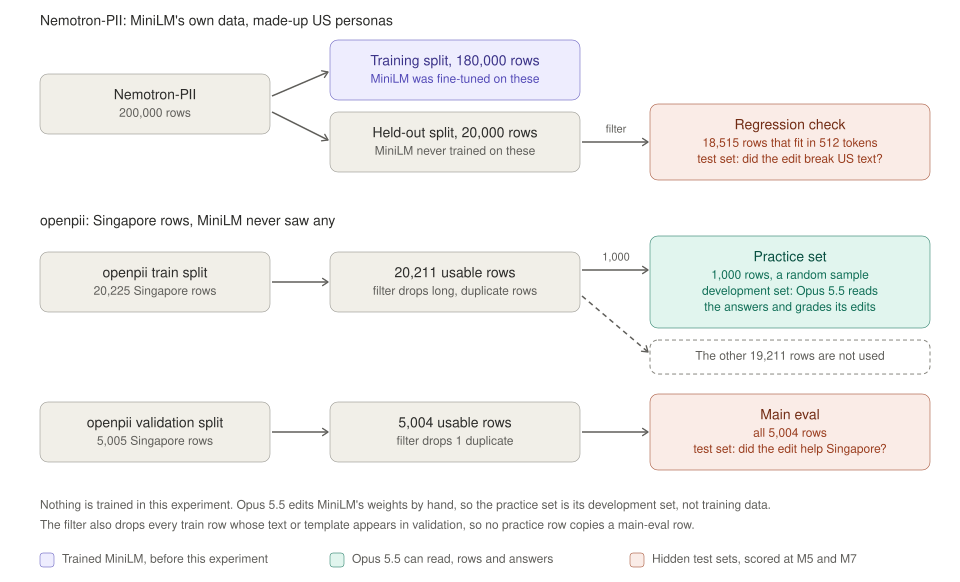
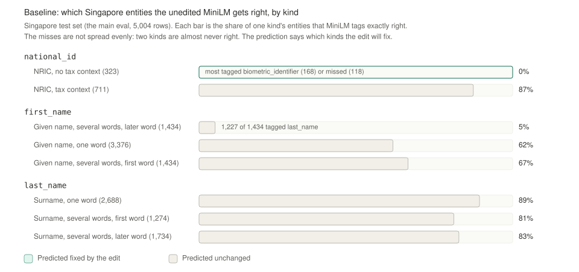

# M5 report: freeze and baseline

M5 freezes everything that decides a score, then scores the unedited MiniLM on every set. It writes `lock.json`, checks that the Singapore data leaves something to repair, records a prediction for each category, and estimates what the 50-pass run in M6 will cost. It follows §4, §5 and §7 of [weight-space-pii-handoff.md](weight-space-pii-handoff.md), with the decisions in the M2, M3 and M4 reports.

Status: built and run on 2026-11-05, and committed on `main` in six commits. Waiting for Desmond to review the items under "Show me".

## What you need to know first

The brief and four earlier reports hold the background. This section restates what M5 depends on. Each step builds on the one before it.

1. **Two AI models take part.** MiniLM (`MiniLM-L6-finetuned-pii-detection`) is the small model being edited. It tags each word of a text as a type of personal information, such as `first_name` or `national_id`, or as nothing. Opus 5.5 does the editing. The brief calls Opus 5.5 "the editor". It reads MiniLM's weights, runs experiments through a harness, and changes numbers inside MiniLM.
2. **The question is whether direct weight edits help.** MiniLM learned from American data, Nemotron-PII, and makes mistakes on Singapore text. The paper this experiment copies found that weight edits can remove an obstacle that hides an ability a model already has, but cannot add a missing one. This experiment asks whether the same holds for MiniLM.
3. **MiniLM was trained before this experiment, and nothing is trained during it.** MiniLM's makers fine-tuned it on 180,000 rows of Nemotron-PII and held back the other 20,000. In this experiment Opus 5.5 changes MiniLM's weights by hand. No step runs a training algorithm.
4. **Opus 5.5 works on a practice set of 1,000 Singapore rows.** openpii's `train` split has 20,211 usable Singapore rows, and M3 drew 1,000 of them at random with a fixed seed. Opus 5.5 reads these rows with their answers, runs MiniLM on them, and grades its edits on them. In machine-learning terms the practice set is a development set, not training data. The other 19,211 rows are not used, because the brief sampled the practice set to a size Opus 5.5 can work through.
5. **Two hidden test sets measure the result.** The main eval is the Singapore test set: every usable row of openpii's `validation` split, 5,004 rows. It asks whether the edit helped on Singapore text. The regression check is the US test set: the 18,515 of Nemotron's 20,000 held-out rows that fit in MiniLM's 512-token limit. It asks whether the edit broke anything on text like MiniLM's training data. Opus 5.5 never sees either set. Each uses every usable row, so its standard error is small.
6. **Three labels count on Singapore text.** They are `first_name`, `last_name` and `national_id`, where `national_id` means an NRIC. M3 set two scoring rules. Names are scored one word at a time, and a `tax_id` tag on an NRIC counts as right.
7. **M3 found that the NRIC failure depends on the words before it.** When "tax" appears in the 60 characters before an NRIC, MiniLM tags it `tax_id`, which scores as right. Without "tax" there, MiniLM got none of the practice NRICs right. M3 named this the likely target of an edit.
8. **M4 built the harness and dry-ran it.** The harness is the driver, a sandboxed Python kernel, the forward-pass server, and the `save_edit` rules. Two dry runs with Opus 5.5 showed it works end to end, and recorded the tokens and dollars each turn costs.
9. **M5's job is to freeze the experiment and measure the starting point.** After M5, nothing that decides a score or what Opus 5.5 sees may change. M5 hashes the sets, the scoring code, the server, the prompt, MiniLM's files, the environment and the baseline code into `lock.json`, together with the settings the run will use. It then scores the unedited MiniLM. That baseline is what M7 compares the edited MiniLM against.



The first figure shows where the three sets come from and what each one is for. Read each band from left to right, from source dataset, through the filter, to the set. The top band is Nemotron-PII, MiniLM's own data. Its purple training split shaped MiniLM before this experiment, and its held-out split becomes the regression check. The bottom band is openpii's Singapore rows, which MiniLM never saw. The green practice set is the only set Opus 5.5 can open. The two red sets are the hidden test sets that M5 and M7 score. The dashed box is the part of the `train` split that no step uses.



The second figure shows the baseline. The top two bars are the gate, F1 on the three scored labels for each dataset. The lower bars split the Singapore entities by kind and show the share MiniLM gets right. The bar outlined in green is the one kind the prediction expects the edit to fix. [docs/figures/report_figures.py](figures/report_figures.py) generates both figures and the lock figure below.

## Decisions

These choices fill gaps in the brief. Desmond can change any of them before M6.

| Item | Brief | Decision |
|---|---|---|
| Restart sentence in the prompt | §6 says `notes.md` "is shown to you again if the conversation is restarted", and §2 step 5 builds the restart only if a run fills the context | Keep the sentence, word for word as in the brief and the paper. The restart lives in the driver, which the lock does not cover, so it can still be built before or during M6 |
| What the lock covers | Eval sets, scoring code, forward-pass server, prompt | Those four, plus MiniLM's files, the environment (`uv.lock`, the `srt` pin in `kernel_host.py`, and the Node version), the code that defines the prediction's categories, the prediction itself, and the run settings. This closes the M4 open item that `srt` sat outside `uv.lock` |
| The driver | Not named | Not hashed, so the restart can still be built. The lock instead records every value the driver passes to Opus 5.5 or states in the prompt: the exact `claude` command, its environment, the CLI version, 300 code runs, 900 s per run, and no turn cap |
| Run name | Not set | `p50`, after the paper's `p50c`. The name sets the paths in the prompt, so the lock fixes it |
| Gate standard error | "twice its bootstrap standard error" | Check both readings: the Singapore F1's own standard error, and the standard error of the gap. The gate passes only if both pass |
| Where the prediction lives | The run folder | [docs/m5_prediction.md](m5_prediction.md). `runs/` is gitignored, and the driver refuses to start a run whose folder exists. M6 copies the file into `runs/p50/` |
| Failing rows to show | Ask Desmond | 12, Desmond's choice |

## The lock

[scripts/freeze.py](../scripts/freeze.py) renders the 50-pass prompt into [docs/m5_task_prompt.txt](m5_task_prompt.txt), then writes `lock.json` through [src/wsp/lock.py](../src/wsp/lock.py). It hashes 25 files in seven groups and records the run settings. `lock.json` has SHA-256 `fe387f86…4f53d9`, and `runs/base/baseline.json` records the same hash. `wsp.lock.write` refuses to replace an existing lock, so the freeze happens once.

The run settings are what `wsp.lock.run_settings` returns. It builds the driver's own `Editor` and takes the exact `claude` command it would run, without the session ID. It adds the environment, the output of `claude --version` (2.1.292), the cap of 300 code runs, the 900 s kernel timeout and the turn cap, which is none. `scripts/run_editor.py` recomputes these for the run it is asked to start. It refuses `p50` if any of them differ, if `runs/p50/` already exists without `--overwrite`, or if the rendered prompt differs from the frozen one. It checks the folder before it touches the box, so an accidental rerun cannot wipe Opus 5.5's `work/` folder. A check against the real lock refused effort `high`, budget 49 and a turn cap of 30, each with the name of the setting that differed, and allowed the locked settings.


This figure shows what the lock covers and who checks it. The purple boxes at the top are seven groups of files and the run settings. All of them go into `lock.json`, one SHA-256 hash per file plus the settings themselves. The three boxes at the bottom are the steps that compare the working tree with `lock.json` before they run. The green ones exist now. `scripts/baseline.py` refuses to score if any file differs. `scripts/run_editor.py` refuses to start the locked run unless its settings match too, and it renders the prompt it would send and compares it with the frozen copy. M7's scoring script does not exist yet and must call the same check.

The rendered prompt matches the M4 dry-run prompt except in two places, the budget (50 instead of 2) and the box name (`p50` instead of `dry2`). The M4 report said these would be the only changes.

`wsp.lock.check` compares every hash and the Node version, and raises with a list of what differs. [tests/test_lock.py](../tests/test_lock.py) covers an unchanged tree, a changed file, a missing file, and a second freeze.

### The lock was written twice

The first freeze hashed 22 files in six groups. An independent review found that it left out the run settings, so `--effort high` would have passed every check. It also left out the code that defines the prediction's categories. Nothing was committed, so M5 deleted the first lock and froze again with the settings and the `baseline` group added. All 22 hashes from the first lock are unchanged in the second. The baseline was rerun against the second lock and gave identical scores, gate and per-kind tables.

## Baseline

[scripts/baseline.py](../scripts/baseline.py) checks the lock, runs the unedited MiniLM on all three sets, and grades each with `wsp.score.grade`. It writes `runs/base/baseline.json` and MiniLM's predicted spans for every row, `runs/base/pred_<set>.jsonl`, which M7 needs for the paired comparison. The run takes 2 minutes on CPU.

This is the base row of the main table from §5 of the brief. The ± values are bootstrap standard errors over rows.

| Model | Singapore F1 | Nemotron F1, all labels | Mechanism metric | Weights changed |
|---|---|---|---|---|
| Base | 0.674 ± 0.004 | 0.952 ± 0.001 | chosen at M7 | none |

Per label, on the three scored labels:

| Label | Singapore F1 | Precision | Recall | Nemotron F1 |
|---|---|---|---|---|
| `first_name` | 0.580 | 0.691 | 0.499 | 0.985 |
| `last_name` | 0.743 | 0.657 | 0.856 | 0.984 |
| `national_id` | 0.737 | 0.953 | 0.602 | 0.959 |
| All three | 0.674 | 0.684 | 0.664 | 0.984 |

On Singapore text, MiniLM makes 5,555 errors. 3,051 are the wrong type, 689 are missed entities, 619 are wrong boundaries, and 1,196 are false positives.

On the practice set the baseline gives F1 0.682, the same value M3 reported. The frozen pipeline reproduces the earlier number.

## The gate passes

The gate asks whether MiniLM does worse on Singapore text than on the text it was trained on, by more than noise. On the three scored labels, Singapore F1 is 0.674 and Nemotron F1 is 0.984. The gap is 0.310.

| Reading of "its standard error" | Standard error | Twice it | Passes |
|---|---|---|---|
| Singapore F1 | 0.0042 | 0.0083 | yes |
| The gap, from both sets' standard errors | 0.0044 | 0.0087 | yes |

The gap is 36 times the stricter threshold, so the reading does not matter.

## Where MiniLM fails

[src/wsp/outcomes.py](../src/wsp/outcomes.py) records what happened to each gold entity and sorts it by kind. On practice it reproduces M3's numbers exactly: 134 of 159 NRICs right with tax context, 0 of 61 without. Its count of right entities equals the grader's true positives, 1,738 on practice.

On the main eval:

| Kind | Entities | Right | Most common errors |
|---|---|---|---|
| NRIC, no tax context | 323 | 0% | `biometric_identifier` 168, missed 118 |
| NRIC, tax context | 711 | 87% | `biometric_identifier` 37, boundary 24 |
| Given name of several words, later word | 1,434 | 5% | `last_name` 1,227 |
| Given name of one word | 3,376 | 62% | `last_name` 766, missed 212 |
| Given name of several words, first word | 1,434 | 67% | `last_name` 294, missed 69 |
| Surname of one word | 2,688 | 89% | missed 78, `first_name` 77 |
| Surname of several words, first word | 1,274 | 81% | `first_name` 72, `company_name` boundary 57 |
| Surname of several words, later word | 1,734 | 83% | missed 117, `company_name` boundary 90 |

Two findings matter for M6 and M7.

1. **The biggest single failure is a labelling convention.** openpii marks names like "Enie Idilia" as one given name. MiniLM types the second word as `last_name` 1,227 times out of 1,434. Nemotron almost never has a given name of more than one word, so this gap comes from the two datasets' conventions, not from anything about Singapore.
2. **The NRIC fix has a small ceiling on overall F1.** If an edit got all 323 NRICs without tax context right and changed nothing else, Singapore F1 would rise by 0.017. That is about four times the Singapore standard error, so a full fix is detectable but small. The mechanism metric in M7 has to carry most of the NRIC result.

## Prediction

[docs/m5_prediction.md](m5_prediction.md) records the prediction for each kind before the run. It predicts that the edit fixes NRICs without tax context and leaves every name kind unchanged. Overall Singapore F1 rises by 0.005 to 0.015, and the regression check stays within two standard errors. It also says which results would contradict the paper's pattern. The prediction has its own commit on `main`, made before M6, so its timestamp shows it came before the run.

## Failing rows

[docs/m5_failing_rows.md](m5_failing_rows.md) shows 12 main-eval rows, generated by [scripts/failing_rows.py](../scripts/failing_rows.py) with a fixed seed. Rows 1 to 8 each show one failure: an NRIC with and without tax context, a given name typed as a surname, misses, a boundary error, and a false positive. Rows 9 to 12 hold the most failures among the rest. MiniLM gets 10 of 47 scored entities right on these rows.

Two patterns show up that no table above isolates:

- MiniLM tags titles such as `Mstr`, `Miss` and `Judge` as `first_name`. These count as false positives.
- MiniLM breaks hyphenated names such as `Ionel-Florin` and `Marie-France` at the hyphen, so they score as boundary errors.

## Cost estimate

[scripts/estimate_cost.py](../scripts/estimate_cost.py) extrapolates from dry run 2. It leaves out dry run 1, whose per-call `cost` field holds the CLI's running total, the logging bug M4 fixed. A least-squares fit of dry run 2's per-call costs to its token counts recovers the prices exactly, with a largest error of 4 × 10⁻¹⁶ dollars. The prices are $4 per million input tokens, $8 to write the cache, $0.20 to read it, and $20 for output.

Each turn in dry run 2 added about 3,800 tokens of context and 2,900 output tokens. Every turn rereads the whole context from the cache, so cost grows with the square of the turn count. The paper's only 50-pass run, `p50c`, took 158 turns. Its 10-pass run took 74.

| Scenario | Turns | Cost | Wall time | Context at the end |
|---|---|---|---|---|
| As long as the paper's 10-pass run | 74 | $8.67 | 0.8 h | 284,000 tokens |
| As long as the paper's 50-pass run | 158 | $23.58 | 1.6 h | 605,000 tokens |
| Long | 250 | $46.09 | 2.5 h | 956,000 tokens |

These numbers are estimates, and each rests on an assumption that M6 will test:

- The wall time is a floor. It counts 35 s per reply, the dry-run mean. Code runs in dry run 2 took 0.04 s on average and its one forward pass took 6 s. Real analysis code and forward passes with activations will take longer. The paper's `p50c` took 20.3 hours, but most of that was Qwen generating text, which MiniLM does not do.
- The estimate assumes the context grows without limit. If the CLI compacts the conversation, the reread context shrinks, but the new context is written to the cache at $8 per million tokens. The cost is roughly an upper bound for a given turn count. The context window of Opus 5.5 is not recorded anywhere in this project, so whether 605,000 tokens fits is unmeasured.
- The cost is the API-price equivalent the CLI reports. The run uses the claude.ai subscription, so the real limit is the subscription's usage cap, not dollars.

## Show me

- The baseline table: the main table and per-label tables above.
- Per-category scores: the "Where MiniLM fails" table.
- 12 failing rows: [docs/m5_failing_rows.md](m5_failing_rows.md).
- The prediction: [docs/m5_prediction.md](m5_prediction.md).
- The cost estimate: the table above.

## Reproduce M5

Run these commands from the repository root.

1. Run the tests.

	```bash
	uv run python -I -m unittest discover -s tests
	```

2. Freeze. This step runs once and refuses if `lock.json` exists.

	```bash
	uv run python -I scripts/freeze.py
	```

3. Score the unedited MiniLM and run the gate. This writes `runs/base/`.

	```bash
	uv run python -I scripts/baseline.py
	```

4. Render the failing rows.

	```bash
	uv run python -I scripts/failing_rows.py
	```

5. Estimate the run's cost.

	```bash
	uv run python -I scripts/estimate_cost.py
	```

6. Regenerate the figures.

	```bash
	uv run python -I docs/figures/report_figures.py
	```

## Independent review

A separate Opus 5.5 subagent reviewed the M5 code. It had the brief and the earlier reports as context, but not this session's reasoning. It found no bug in the scoring, the gate or the prediction numbers. It compared `wsp.outcomes` and the failing-rows false positives with `wsp.score.grade` on all 6,004 Singapore rows and found no row that disagreed. It made five findings, and M5 fixed all five.

| Finding | Severity | Action |
|---|---|---|
| The lock leaves out the run settings, such as effort and the system prompt | High | Fixed. The lock records them and `run_editor.py` checks them |
| Nothing protects `lock.json` itself, which is untracked | Medium | Fixed. `lock.json` and the prediction are committed. M7 still has to compare the lock hash with `baseline.json` |
| The prediction's categories and the prediction are outside the lock | Medium | Fixed. They are the `baseline` group, and `baseline.json` records the hash of each prediction file |
| `check_locked_run` uses `assert` and can wipe `work/` on a rerun | Low | Fixed. It raises errors and checks the run folder first |
| The wall time is a floor, and compaction rewrites the cache | Low | Fixed in the estimate's wording |

## Open items

- **M7's scoring must call `wsp.lock.check` and compare the lock hash with `baseline.json`.** The script does not exist yet.
- **A `claude` update blocks M6.** The lock records CLI version 2.1.292. If the CLI updates itself before M6, `run_editor.py` refuses to start, and the M4 context check has to be repeated on the new version before the lock is renewed.
- **The restart is still unbuilt, and the paper's run needed it.** The paper restarted its conversation every 40 turns, and `p50c` used 4 conversations. At 158 turns this run's context would reach about 605,000 tokens. If that exceeds the window, the CLI compacts the conversation instead, and Opus 5.5 does not see `notes.md` again as the prompt promises. `run.json` records whether compaction happened. The restart is a driver change outside the lock.
- **The M4 open items about usage limits and daemonized children are unchanged.**
