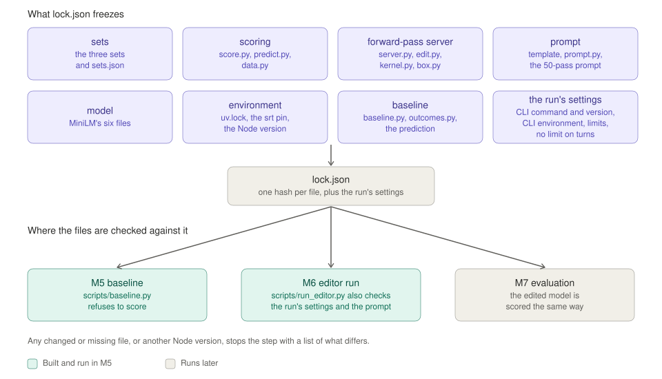

# M5 report: freeze and baseline

M5 freezes everything that decides a score, then scores the unedited MiniLM on every set. It writes `lock.json`, checks that the Singapore data leaves something to repair, records a prediction for each category, and estimates what the 50-pass run in M6 will cost. It follows §4, §5 and §7 of [weight-space-pii-handoff.md](weight-space-pii-handoff.md), with the decisions in the M2, M3 and M4 reports.

Status: built and run on 2026-11-05 and committed on `main`, where `git log` lists every M5 commit. `lock.json` was re-frozen six times: four times after reviews and once for a `claude` update, all on 2026-11-05, and once on 2026-11-06 to score given names and surnames as one category. Waiting for Desmond to review the items under "Show me".

## What you need to know first

The brief and four earlier reports hold the background. This section restates what M5 depends on. Each step builds on the one before it.

1. **Two AI models take part.** MiniLM (`MiniLM-L6-finetuned-pii-detection`) is the small model being edited. It tags each word of a text as a type of personal information, such as `first_name` or `national_id`, or as nothing. Opus 5.5 does the editing. The brief calls Opus 5.5 "the editor". It reads MiniLM's weights, the numbers inside MiniLM, and changes some of them. It runs its experiments through a harness, the code that runs Opus 5.5's session.
2. **The question is whether direct weight edits help.** MiniLM learned from American data, Nemotron-PII, and makes mistakes on Singapore text. The paper this experiment copies found that weight edits can remove an obstacle that hides an ability a model already has, but cannot add a missing one. This experiment asks whether the same holds for MiniLM.
3. **MiniLM was trained before this experiment, and nothing is trained during it.** MiniLM's makers fine-tuned it on 180,000 rows of Nemotron-PII and held back the other 20,000. In this experiment Opus 5.5 changes MiniLM's weights by hand. No step runs a training algorithm.
4. **Opus 5.5 works on a practice set.** The practice set is 1,000 rows of Singapore text, each with its answers. Opus 5.5 runs MiniLM on these rows and uses the answers to check whether its edits help. Nothing trains on the practice set.
5. **The practice set is a small sample from openpii.** The Singapore text comes from openpii, a dataset MiniLM never saw. Its `train` split has 20,211 usable rows. M3 drew 1,000 of them, a number of rows Opus 5.5 can work through, at random with a fixed seed. A seed makes a random draw repeatable. The other 19,211 rows are not used.
6. **Two hidden test sets measure the result.** Opus 5.5 never sees either one. The main eval asks whether the edit helped on Singapore text. It is every usable row of openpii's `validation` split, 5,004 rows. The regression check asks whether the edit broke anything on text like MiniLM's training data. It is the 18,515 of Nemotron's 20,000 held-out rows that fit in MiniLM's 512-token limit, where a token is one of the word pieces MiniLM splits text into. Both sets are scored by F1, which combines precision, the share of MiniLM's tags that are right, and recall, the share of real entities it finds, into one score. Each set uses every usable row, so its standard error, how much the score would move on a fresh draw of rows, is small.


The figure shows points 3 to 6. Read each row of the figure from left to right, from source dataset, through the filter, to the set. The top row is Nemotron-PII, MiniLM's own data. Its purple training split shaped MiniLM before this experiment (point 3), and its held-out split becomes the regression check (point 6). The lower two rows are openpii's Singapore data. The train split gives the green practice set (points 4 and 5), the only set Opus 5.5 can open, and the validation split gives the main eval (point 6). The two red sets are hidden from Opus 5.5.

The dotted line marks M5's part. Everything outside it existed before M5: MiniLM's training, and the filters and samples from M2 and M3. M5 hashes the three sets inside it into `lock.json` and scores the unedited MiniLM on each. A hash is a file's fingerprint, which shows whether the file changed. The regression check's F1 of 0.952 covers all of MiniLM's labels, because an edit could break a label, such as `email`, that the Singapore sets do not score. The check that there is something to repair, further down, compares only the two Singapore labels on both datasets, so it shows Nemotron at 0.988. [docs/figures/report_figures.py](figures/report_figures.py) generates this figure and the others in this report.

7. **Two labels count on Singapore text.** They are `name` and `national_id`, where `national_id` means an NRIC, Singapore's identity card number. Given names and surnames are scored as one category, `name`. A word MiniLM tags `first_name` or `last_name` counts as right on any name word, whichever of the two openpii marks it. Names are scored one word at a time, and a `tax_id` tag on an NRIC counts as right. On the Nemotron regression check every label is scored separately, so there `first_name` and `last_name` stay apart.
8. **M3 found that the NRIC failure depends on the words before it.** When "tax" appears just before an NRIC, MiniLM tags it `tax_id`, which scores as right. In this report "just before" means within the 60 characters before the number, about ten words. Without "tax" there, MiniLM got none of the practice NRICs right. M3 named this the likely target of an edit.
9. **M4 built the harness and dry-ran it.** The harness is the driver, which carries messages between Opus 5.5 and the other parts, plus a Python kernel, the forward-pass server, and the `save_edit` rules on which edits are allowed. The kernel runs Opus 5.5's code inside a walled-off area, set up by `srt`, where code can reach only the folders listed for it. The server does each forward pass, one run of MiniLM over some texts. Two dry runs, short test runs with Opus 5.5, showed the harness works end to end, and recorded the tokens and dollars each turn costs.
10. **M5's job is to freeze the experiment and measure the starting point.** After M5, nothing that decides a score or what Opus 5.5 sees may change. M5 hashes the sets, the scoring code, the server, the prompt, MiniLM's files, the environment and the baseline code into `lock.json`, together with the run's settings: the CLI command, its version and environment, and the limits. It then scores the unedited MiniLM. That baseline is what M7 compares the edited MiniLM against.

## Decisions

These choices fill gaps in the brief. Desmond can change any of them before M6.

| Item | Brief | Decision |
|---|---|---|
| Restart sentence in the prompt | §6 says `notes.md` "is shown to you again if the conversation is restarted", and §2 step 5 builds the restart only if a run fills the context | Keep the sentence, word for word as in the brief and the paper. The restart lives in the driver, which `lock.json` does not cover, so it can still be built before or during M6 |
| What `lock.json` covers | Eval sets, scoring code, forward-pass server, prompt | Those four, plus MiniLM's files, the environment (`uv.lock`, the `srt` pin in `kernel_host.py`, and the Node version), the code that defines the prediction's categories, the prediction itself, and the run's settings. This closes the M4 open item that `srt` sat outside `uv.lock` |
| The driver | Not named | Not hashed, so the restart can still be built. `lock.json` instead records every value the driver passes to Opus 5.5 or states in the prompt: the exact `claude` command, its whole environment, the CLI version, 300 code runs, 900 s per run, and no limit on turns |
| Run name | Not set | `p50`, after the paper's `p50c`. The name sets the paths in the prompt, so `lock.json` fixes it |
| Standard error for the check that there is something to repair | "twice its bootstrap standard error" | Check both readings: the Singapore F1's own standard error, and the standard error of the gap. The check passes only if both pass |
| Where the prediction lives | The run folder | [docs/m5_prediction.md](m5_prediction.md). Git does not track `runs/`, and the driver refuses to start a run whose folder exists. M6 copies the file into `runs/p50/` |
| Failing rows to show | Ask Desmond | 12, Desmond's choice |
| How names are scored on Singapore text | §3 maps openpii's `GIVENNAME` to `first_name` and `SURNAME` to `last_name`, and scores both | Desmond's choice, on 2026-11-06. Given names and surnames are scored as one category, `name`, on both the gold and the predicted side. Which word openpii calls the surname is a convention a reader often cannot check, and hiding a name does not depend on it. The Nemotron regression check scores every label separately. Put into the scoring by the seventh freeze |
| Explaining each step | §6 step 5 opens "Before each code block, explain the step in plain English" | Desmond's choice. The paper's "EXPLAIN EVERY STEP" paragraph replaces that sentence, word for word and from turn 1. The paper added it mid-run, at turn 29 of `p50c`, and its final prompt holds it between HOW TO WORK and RULES, as ours does |

## `lock.json`

[scripts/freeze.py](../scripts/freeze.py) renders the 50-pass prompt into [docs/m5_task_prompt.txt](m5_task_prompt.txt), then writes `lock.json` through [src/wsp/lock.py](../src/wsp/lock.py). It hashes 25 files in seven groups and records the run's settings. `lock.json` has SHA-256 `e26da9fd…1449bea1`, and `runs/base/baseline.json` records the same hash. `wsp.lock.write` refuses to replace an existing `lock.json`, so every freeze is deliberate. The old file has to be deleted by hand first.

The run's settings are what `wsp.lock.run_settings` returns. It builds the driver's own `Editor` and takes the exact `claude` command it would run, without the session ID. It adds the CLI's environment, the output of `claude --version` (2.1.318), the limit of 300 code runs, the 900 s kernel timeout and the limit on turns, which is none. `scripts/run_editor.py` recomputes these for the run it is asked to start. It refuses `p50` if any of them differ, if `runs/p50/` already exists without `--overwrite`, or if the rendered prompt differs from the frozen one. It checks `runs/p50/` before it touches the folders of the walled-off area, so an accidental rerun cannot wipe Opus 5.5's `work/` folder. A check against the real `lock.json` refused effort `high`, budget 49 and a limit of 30 turns, each with the name of the setting that differed, and allowed the locked settings. It also refuses names such as `P50` or `p50 ` that match the locked name once case and spaces are ignored. This disk ignores case, so `P50` would otherwise skip every check and still write into `runs/p50/`.

The CLI's environment is built from scratch, not copied from the Claude desktop app. The app sets about 37 Claude variables, among them `CLAUDE_EFFORT=high` and `DISABLE_MICROCOMPACT=1`, and dry runs 2 and 3 inherited all of them. `--effort max` still won: every reply in both runs logged effort `max`. The driver now passes only `HOME`, `USER`, `LOGNAME`, `PATH`, `LANG`, `TMPDIR`, `SHELL` and `CLAUDE_CONFIG_DIR`, and sets `CLAUDE_CODE_DISABLE_AUTO_MEMORY=1` and `DISABLE_AUTOUPDATER=1`, so the CLI cannot update itself mid-run. `lock.json` records both lists. A real call through the new environment signed in with the subscription, answered at effort `max`, and logged `sdk-cli` as the program that started it, where the dry runs logged `claude-desktop`.



This figure shows what `lock.json` covers and who checks it. The purple boxes at the top are seven groups of files and the run's settings. All of them go into `lock.json`, one SHA-256 hash per file plus the settings themselves. The three boxes at the bottom are the steps that compare the current files with `lock.json` before they run. The green ones exist now. `scripts/baseline.py` refuses to score if any file differs. `scripts/run_editor.py` refuses to start the locked run unless its settings match too, and it renders the prompt it would send and compares it with the frozen copy. M7's scoring script does not exist yet and must call the same check. [docs/figures/report_figures.py](figures/report_figures.py) generates it.

The rendered prompt differs from the M4 dry-run prompt in four ways. The budget is 50 instead of 2, and the run name is `p50` instead of `dry2`, the two changes the M4 report expected. The third is the paper's "EXPLAIN EVERY STEP" paragraph, added by the fourth freeze below. The fourth is scoring rule (1), which now says that on Singapore text `first_name` and `last_name` count as one category, `name`, and that on the standard PII texts the two are not merged. Two clauses of the prompt appear in no report, though both were already in the M4 prompt. One says that on the standard PII texts all 55 categories are scored and the `tax_id` rule is off. The other says the forward-pass tool grades practice items per category under the same scoring rules.

`wsp.lock.check` compares every hash and the Node version, and stops with an error that lists what differs. [tests/test_lock.py](../tests/test_lock.py) covers unchanged files, a changed file, a missing file, and a second freeze.

### `lock.json` was frozen seven times

The first freeze hashed 22 files in six groups. An independent review found that it left out the run's settings, so `--effort high` would have passed every check. It also left out the code that defines the prediction's categories. Nothing was committed, so M5 deleted the first `lock.json` and froze again with the settings and the `baseline` group added. All 22 hashes from the first freeze are unchanged in the second. The baseline was rerun after the second freeze and gave identical scores, per-category tables, and numbers for the check that there is something to repair.

The second `lock.json` was committed. A later review, described under "Second review" below, found two flaws in the prediction. On 2026-11-05 Desmond approved a third freeze to fix them before M6, since M6 has not run and the prediction still comes before any result. Two files changed. `docs/m5_prediction.md` got the fixes, and `scripts/baseline.py` now records the Python, PyTorch and Transformers versions, the platform and the thread count in `baseline.json`. The other 23 hashes and the run's settings are unchanged, and the rendered prompt is byte for byte the same. The baseline rerun after the third freeze gave MiniLM predictions with the same SHA-256 on all three sets, and identical scores, per-category tables, and numbers for the check that there is something to repair.

A comparison of our prompt with the paper's found that the paper's final prompt, `exp8_math/runs/p50c/message.txt`, holds an "EXPLAIN EVERY STEP" paragraph that its first-turn prompt, the one the brief adapted, does not. On 2026-11-05 Desmond approved a fourth freeze to add it. The paragraph asks for 3 to 8 sentences before every block and a summary of the path to the edits in the final answer. Two files changed, the template `src/wsp/harness/task_prompt.txt` and the rendered `docs/m5_task_prompt.txt`. The paragraph matches the paper's character for character. The run's settings are unchanged, and the baseline rerun gave the same prediction hashes and identical scores again. The paper also sent back a block that came without an explanation, at most twice in a row. That check is still unbuilt, as the M4 report lists, so the paragraph is an instruction only.

A third review, by Fable 5.1, found that the CLI inherited the Claude desktop app's whole environment. On 2026-11-05 Desmond approved a fifth freeze so that the driver passes on only a fixed list of variables, described under "`lock.json`" above. No file hash changed. Two of the run's settings did: `cli_env` gained `DISABLE_AUTOUPDATER=1`, and the new `cli_env_passed` lists the passed-through variables. The baseline rerun gave the same prediction hashes and identical scores.

Before M6, another launch of `claude` updated the CLI from 2.1.292 to 2.1.318, so the locked run would refuse to start. On 2026-11-05 Desmond approved a sixth freeze after a new check of what reaches Opus 5.5, described under "The check of what reaches Opus 5.5 on 2.1.318" below. One line of `lock.json` changed, `cli_version`. No file hash changed, and the rendered prompt is byte for byte the same. The baseline rerun gave MiniLM predictions with the same SHA-256 on all three sets, and `baseline.json` differs from the fifth freeze's only in `lock_sha256`.

On 2026-11-06 Desmond decided that on Singapore text given names and surnames are scored as one category, `name`, as the Decisions table records, and the seventh freeze put this into the scoring. `wsp.score.merged` counts `first_name` and `last_name` as `name` wherever `name` is scored, on both the gold and the predicted side, and `SG_LABELS` is now `name` and `national_id`. The all-label regression check scores every label, so the merge is off there. Five file hashes changed: `src/wsp/score.py`, `src/wsp/outcomes.py`, the template `src/wsp/harness/task_prompt.txt` and the rendered `docs/m5_task_prompt.txt`, whose rule (1) now says the two count as one category, and `docs/m5_prediction.md`, rewritten for the new numbers. The run's settings are unchanged. MiniLM's predictions are byte for byte the same, so only the scores changed. To get the numbers for the prediction, the baseline first ran against a `lock.json` that held the old prediction. `lock.json` was then written again with the new prediction and the baseline rerun, and the second run's `baseline.json` differed from the first only in `lock_sha256`. Under the old scoring Singapore F1 was 0.674, and 3,051 of MiniLM's errors there were the wrong type. 1,227 of those were the later words of a given name of several words, such as "Idilia" in "Enie Idilia", tagged `last_name`. Three new tests in [tests/test_score.py](../tests/test_score.py) cover the merge, and all 103 tests pass.

## Baseline

[scripts/baseline.py](../scripts/baseline.py) checks `lock.json`, runs the unedited MiniLM on all three sets, and grades each with `wsp.score.grade`. It writes `runs/base/baseline.json` and MiniLM's predicted spans for every row, `runs/base/pred_<set>.jsonl`, where a span is a stretch of text with one label. M7 needs these for the paired comparison, which scores both models on the same rows. Its standard error comes from scoring both on the same random redraws of rows. The run takes 2 minutes on CPU.

The predictions are reproducible on this machine, a MacBook Pro with an M4 Pro. Three runs of the main eval gave the same spans on all 5,004 rows: with 1 PyTorch thread, with 14, and on the Apple GPU through MPS. The GPU took 5.4 s against 10.5 s on CPU. Scoring stays on CPU anyway. The saving is a few minutes in a run of hours, and moving to the GPU would change `predict.py` and the server, both locked, for a guarantee only measured on one set. Another machine may compute MiniLM's label scores very slightly differently and flip a word whose top two labels almost tie, so M7 should score on this machine and compare its environment with the one `baseline.json` records.

This is the base row of the main table from §5 of the brief. The ± values are bootstrap standard errors over rows.

| Model | Singapore F1 | Nemotron F1, all labels | Mechanism metric | Weights changed |
|---|---|---|---|---|
| Base | 0.865 ± 0.003 | 0.952 ± 0.001 | chosen at M7 | none |

Per label, on the two scored labels. On Singapore text MiniLM gets 11,056 entities right, with 1,535 false positives and 1,918 entities not right.

| Label | Singapore F1 | Precision | Recall | Nemotron F1 |
|---|---|---|---|---|
| `name` | 0.874 | 0.874 | 0.874 | 0.989 |
| `national_id` | 0.737 | 0.953 | 0.602 | 0.959 |
| Both | 0.865 | 0.878 | 0.852 | 0.988 ± 0.001 |


This figure draws the per-label table. Each label has a pair of bars, Singapore in red above Nemotron in grey. MiniLM trails on both labels, and most on `national_id`. The pair below the line has both labels counted together, and it is the pair that the check that there is something to repair compares. Counted together, every entity counts once, rather than the two labels' scores being averaged. Names are 92% of the Singapore entities, so they pull that score to 0.865, above the mean of the two, 0.806. The note under the pair gives the gap, 0.123, and the check's threshold, twice the gap's standard error, 0.0060. [docs/figures/report_figures.py](figures/report_figures.py) generates it.

On Singapore text, MiniLM makes 3,114 errors. 610 are the wrong type, 689 are missed entities, 619 are wrong boundaries, where the tag covers too many or too few words, and 1,196 are false positives.

On the practice set the baseline gives F1 0.866 ± 0.006. With `first_name` and `last_name` scored separately, as in M3, the same predictions give 0.682, the value M3 reported, so the frozen pipeline reproduces the earlier number.

## The check that there is something to repair passes

The check asks whether MiniLM does worse on Singapore text than on the text it was trained on, by more than noise. On the two scored labels, Singapore F1 is 0.865 and Nemotron F1 is 0.988. The gap is 0.123.

| Reading of "its standard error" | Standard error | Twice it | Passes |
|---|---|---|---|
| Singapore F1 | 0.0028 | 0.0056 | yes |
| The gap, from both sets' standard errors | 0.0030 | 0.0060 | yes |

The gap is 21 times the stricter threshold, so the reading does not matter.

## Where MiniLM fails

[src/wsp/outcomes.py](../src/wsp/outcomes.py) records what happened to each gold entity, one of the correct answers marked in the data, and sorts it into a category. On practice it reproduces M3's numbers exactly: 134 of 159 NRICs with "tax" just before them right, 0 of 61 without. Its count of right entities equals the true positives of the scoring code, 2,207 on practice.

F1 says how far each label falls short. It does not say which entities MiniLM gets wrong, and the prediction and the edit work at that level. So this section splits each label's entities in the main eval, the Singapore test set, into categories. A category is a group of entities that MiniLM might handle differently, such as NRICs with and without "tax" just before them, or the first and later words of a name.


Each bar is the share of one category's entities that MiniLM tags exactly right, with the exact span and the right label. The bars are grouped under the label they belong to, with the name categories split into given names and surnames. The figure uses this share rather than F1 because a false positive has no gold entity, so it belongs to no category. The misses are not spread evenly. One category is almost never right, and the note on it says what MiniLM outputs instead. Its bar, outlined in green, is the one category the prediction expects the edit to fix. [docs/figures/report_figures.py](figures/report_figures.py) generates it.

The table gives the counts and the most common errors on the main eval. A boundary error is listed with the label of the tag that covers too many or too few words.

| Category | Entities | Right | Most common errors |
|---|---|---|---|
| NRIC without "tax" just before it | 323 | 0% | `biometric_identifier` 168, missed 118 |
| NRIC with "tax" just before it | 711 | 87% | `biometric_identifier` 37, `tax_id` boundary 24 |
| Given name of one word | 3,376 | 84% | missed 212, `company_name` boundary 69, `name` boundary 68 |
| Given name of several words, first word | 1,434 | 87% | missed 69 |
| Given name of several words, later words | 1,434 | 91% | missed 41 |
| Surname of one word | 2,688 | 92% | missed 78 |
| Surname of several words, first word | 1,274 | 87% | `company_name` boundary 57, missed 48 |
| Surname of several words, later words | 1,734 | 83% | missed 117, `company_name` boundary 90 |

Two findings matter for M6 and M7.

1. **The name errors left are mostly misses and boundary errors.** A word tagged `first_name` or `last_name` is right on any name word, so no name category is below 83%. What remains are names MiniLM does not tag at all, such as 212 given names of one word, and names it tags as part of a longer stretch, often a company name. No single cause stands out to target. The prediction expects these categories to stay unchanged, because finding a name MiniLM has never seen needs knowledge it lacks.
2. **The NRIC fix can raise overall F1 only a little.** If an edit got all 323 NRICs without "tax" just before them right and changed nothing else, Singapore F1 would rise by 0.014. That is about five times the Singapore standard error, so a full fix is detectable but small. The mechanism metric in M7, the share of the targeted failure that the edit fixed, has to carry most of the NRIC result.

## Prediction

[docs/m5_prediction.md](m5_prediction.md) records the prediction for each category before the run. It predicts that the edit fixes NRICs without "tax" just before them and leaves every name category unchanged. Overall Singapore F1 rises by 0.002 to 0.009, from 33 to 205 more NRICs right. The Nemotron scores stay within 0.005 of the base. It also says which results would contradict the paper's pattern. The prediction has its own commit on `main`, made before M6, so its timestamp shows it came before the run.

## Failing rows

[docs/m5_failing_rows.md](m5_failing_rows.md) shows 12 main-eval rows, generated by [scripts/failing_rows.py](../scripts/failing_rows.py) with a fixed seed. Rows 1 to 7 each show one type of mistake. The other five are the rows with the most mistakes. MiniLM gets 25 of the 56 scored name words and NRICs right on these rows.

Two patterns show up that no table above isolates:

- MiniLM tags titles such as `Mstr`, `Miss` and `Madame` as names. These count as false positives.
- MiniLM breaks hyphenated names such as `Lucian-Stefan` at the hyphen, so they score as boundary errors.

## Cost estimate

[scripts/estimate_cost.py](../scripts/estimate_cost.py) extrapolates from dry run 3, the only run with the locked prompt. The run uses the claude.ai subscription, so nothing is billed. The dollars are what the CLI reports the run would cost at API prices. That figure measures how much of the subscription's usage allowance a run takes. A fit of dry run 3's per-call costs to its token counts recovers the prices exactly, with a largest error of 5 × 10⁻¹⁶ dollars. The prices are $4 per million input tokens, $8 to write the cache, $0.20 to read it, and $20 for output. The cache is where the CLI stores the conversation so that a later call can reread it at the lower price.

Each turn in dry run 3 added about 4,700 tokens of context, the conversation that Opus 5.5 rereads each turn, and 3,800 output tokens. Every turn rereads the whole context from the cache, so usage grows with the square of the turn count. The paper's only 50-pass run, `p50c`, took 158 turns. Its 10-pass run took 74.

| Scenario | Turns | Cost at API prices | Wall time | Context at the end |
|---|---|---|---|---|
| As long as the paper's 10-pass run | 74 | $10.95 | 0.9 h | 349,000 tokens |
| As long as the paper's 50-pass run | 158 | $29.63 | 1.8 h | 744,000 tokens |
| Long | 250 | $57.69 | 2.9 h | 1,177,000 tokens |

The first estimate used dry run 2 and was about 20% low. Fitted to dry run 2, the model gives $1.12 for dry run 3's 12 turns, which cost $1.43. Dry run 3's replies are longer, 3,766 output tokens a turn against 2,876, which fits the EXPLAIN EVERY STEP paragraph it added. That cause is inferred, not measured.

These numbers are estimates, and each rests on an assumption that M6 will test:

- The real wall time will be at least the estimate. It counts 40 s per reply, the dry run 3 mean. Code runs in dry run 3 took 0.02 s on average and its one forward pass took 5 s. Real analysis code and forward passes with activations will take longer. The paper's `p50c` took 20.3 hours, but most of that was Qwen generating text, which MiniLM does not do.
- The estimate assumes the context grows without limit. Opus 5.5's context window in Claude Code, the most text it can hold at once, is 1,000,000 tokens, as the CLI's `/context` command reported on 2026-11-05, with 33,000 held back before the CLI compacts (shortens) the conversation. A run as long as `p50c` ends near 744,000 tokens and fits. Past about 205 turns, the CLI would compact the conversation. Compacting shrinks the reread context but writes the new one to the cache, so for a given turn count the real cost is roughly at most the estimate.
- The real limit is the subscription's usage cap. If the run reaches it, the driver waits and resends on the same conversation for up to 6 hours in all, then stops with an error.

## Show me

- The baseline table: the main table and per-label tables above.
- Per-category scores: the "Where MiniLM fails" table.
- 12 failing rows: [docs/m5_failing_rows.md](m5_failing_rows.md).
- The prediction: [docs/m5_prediction.md](m5_prediction.md).
- The cost estimate: the table above.

## Reproduce M5

Run these commands from the repository root.

1. Run the tests.

	```bash
	uv run python -I -m unittest discover -s tests
	```

2. Freeze. This step runs once and refuses if `lock.json` exists.

	```bash
	uv run python -I scripts/freeze.py
	```

3. Score the unedited MiniLM and run the check that there is something to repair. This writes `runs/base/`.

	```bash
	uv run python -I scripts/baseline.py
	```

4. Render the failing rows.

	```bash
	uv run python -I scripts/failing_rows.py
	```

5. Estimate the run's cost.

	```bash
	uv run python -I scripts/estimate_cost.py
	```

6. Regenerate the figures.

	```bash
	uv run python -I docs/figures/report_figures.py
	```

## Independent review

A separate Opus 5.5 session reviewed the M5 code. It had the brief and the earlier reports as context, but not the main session's reasoning. It found no bug in the scoring, the check that there is something to repair, or the prediction numbers. It compared `wsp.outcomes` and the failing-rows false positives with `wsp.score.grade` on all 6,004 Singapore rows and found no row that disagreed. It made five findings, and M5 fixed all five.

| Finding | Severity | Action |
|---|---|---|
| `lock.json` leaves out the run's settings, such as effort and the system prompt | High | Fixed. `lock.json` records them and `run_editor.py` checks them |
| Nothing protects `lock.json` itself, which git does not track | Medium | Fixed. `lock.json` and the prediction are committed. M7 still has to compare the hash of `lock.json` with `baseline.json` |
| The prediction's categories and the prediction are outside `lock.json` | Medium | Fixed. They are the `baseline` group, and `baseline.json` records the hash of each `pred_<set>.jsonl` file of MiniLM's spans |
| `check_locked_run` uses `assert` and can wipe `work/` on a rerun | Low | Fixed. It stops with an error and checks the run folder first |
| The real wall time will be at least the estimate, and compacting the conversation rewrites the cache | Low | Fixed in the estimate's wording |

### Second review

After the second `lock.json` was committed, Desmond asked for a review of M5. Opus 5.5 reviewed it in the main session, and a separate Fable 5.1 session reviewed it without the main session's conclusions. Both recomputed every number in this report and the prediction from `runs/base/` and found them right. The findings:

| Finding | Severity | Action |
|---|---|---|
| The prediction's regression rule, two paired standard errors, flags 10 wrong entities out of 146,951 as a change | Medium | Fixed in the third freeze. Unchanged now means within 0.005 |
| The prediction's F1 range, 0.005 to 0.015, did not follow from its own claims | Medium | Fixed in the third freeze. It now follows from the number of NRICs that can be fixed, 0.002 to 0.009 |
| 917 ids in `nemotron_eval.jsonl` appear on two rows. Nemotron wrote each template once with a US persona and once with an international one under the same id | Medium | Open for M7, below. The baseline pairs rows by position, so its scores are right |
| `run_editor.py` checks the settings only when the run is named `p50` | Medium | Open for M7, below |
| The run folder leaves out five records an audit would need | Medium | Fixed in the driver, outside `lock.json`. See "Records added to the run folder" below |
| The tests share the folders of the walled-off area, so two test runs at once can fail | Low | Not fixed. Run one test process at a time |
| The cost estimate assumes every turn reads the context from the cache | Low | Not fixed. A slow code run could let the cache expire, which costs a few dollars each time |

### Records added to the run folder

M4 built the run folder to the list in §2 of the brief, which summarises the paper's logs and leaves out two of the paper's files: the CLI's full log of each turn and Opus 5.5's own notes. M4 also never reads `work/` back, because Opus 5.5's code can plant symlinks there, files that point to other places on disk. The dry runs made no real edits, so the gaps did not show. The driver now writes five more records:

| Record | Where | Why |
|---|---|---|
| The edit each forward pass ran | `forward/<k>/edit_manifest.json`, and `forward/<k>/edit.npz` when the edit changed since the last pass. The manifest names the file that holds its changes | A mid-run result can be checked against the weights that produced it. An `original` pass records no edit |
| The CLI version and the hash of `lock.json` | `run.json`, `cli_version` and `lock_sha256` | M7 can tie the run to the locked settings |
| The CLI's conversation log | `cli_session.jsonl` | It holds the id of the model that answered each reply and why each reply ended. The CLI keeps it outside the project |
| Opus 5.5's small files from `work/` | `work_notes/`, with what was left out and why in `run.json` | `notes.md` and Opus 5.5's other files survive a rerun. Files over 1 MB and links of either type are left out, and the copy never follows a link |
| A refusal to start `p50` from uncommitted code | `scripts/run_editor.py` | `run.json`'s git commit then names the exact code that ran |

Three tests in [tests/test_harness.py](../tests/test_harness.py) cover them: the per-pass edits rebuild to the hashes in their manifests, only small plain files are copied, and the CLI's conversation log is copied. The refusal was checked on code with uncommitted changes.

### Dry run 3

A short run with Opus 5.5 tested the new records and the EXPLAIN EVERY STEP paragraph against the real CLI, from commit `a2c4ebf` with no uncommitted changes. It used the locked prompt with a budget of 2 and a limit of 12 turns, under the name `dry3`, so the checks for the locked run did not apply. It took 8 minutes and cost $1.43. Opus 5.5 spent the 12 turns diagnosing. It ran 10 code blocks and one forward pass, on the unedited MiniLM, then submitted no edit.

- **Every record was written.** `run.json` holds the CLI version, 2.1.292, and the hash of `lock.json`, which matches the file. `cli_session.jsonl` was copied, and it shows every reply came from `claude-opus-5-5` and ended with `end_turn`. `work_notes/` holds Opus 5.5's four files, and `notes.md` matches the copy inside the walled-off area byte for byte. The one forward pass records that it ran no edit. The git record says there were no uncommitted changes.
- **Opus 5.5 followed EXPLAIN EVERY STEP.** Ten of its 11 replies with a block opened with 3 to 8 sentences, and one with 9. Each said what the last result showed, what it concluded, and what it would do next and why. About half also said what would confirm or refute a hypothesis. The others were setup steps, and one of them says "Nothing is tested here". The final answer summarises the path in sections, "What I did" and "What I would have done next". Nothing suggests that the paper's check, which sends back a block that comes without an explanation, is needed.
- **The forward request costs turns.** The ```forward block must hold its item ids as literal JSON. Opus 5.5 spent two turns printing 470 ids so it could paste them into the block. This matches the paper's format and costs no forward pass.

The run folder is in `runs/dry3/`. The folder of the walled-off area, 2.1 GB, was deleted.

### Third review

After dry run 3, Desmond had Fable 5.1 review M5 again. It reran the baseline, the `lock.json` check and the tests, and rendered the figures. Every result matched. Opus 5.5 checked each finding before acting on it.

| Finding | Severity | Action |
|---|---|---|
| The CLI inherits the Claude desktop app's whole environment, and nothing records it | High | Fixed in the fifth freeze. The driver passes on only a fixed list of variables, which `lock.json` records. The inherited `CLAUDE_EFFORT=high` had not changed the effort |
| The driver writes every message after the first and is not hashed | Medium | An M7 open item, below. `run.json`'s commit already pins the driver, so no separate hash was added |
| The cost estimate is about 20% low | Medium | Refitted on dry run 3, and reworded as subscription usage |
| A name such as `P50` skips the locked run's checks | Medium | Fixed in `run_editor.py`, outside `lock.json` |
| Stale report text: the commit count, "the freeze happens once", undated approvals, figure scripts, two prompt clauses | Low | Fixed |

A limit on turns was considered and dropped. The paper's runs had none: a run continued until every pass was used, with only the 300 code runs capped.

### The check of what reaches Opus 5.5 on 2.1.318

Before the sixth freeze, M5 repeated the M4 check that nothing but the prompt reaches Opus 5.5, this time on CLI 2.1.318. Three checks agree that the only change is two lines of attached text.

1. **The CLI's own report of the session matches.** With `--output-format stream-json`, the CLI reports at start-up what it loaded, including its list of tools. M5 ran the exact locked command on both installed versions, 2.1.292 and 2.1.318, with `stream-json` in place of `json`. Both list no tools, no MCP servers, no skills and no slash commands, with output style `default`, permission mode `default` and model `claude-opus-5-5`. 2.1.318 loads one more built-in plugin, `cc-plugin-privacy`, and declares five more SDK capabilities.
2. **The context that reaches Opus 5.5 differs in two lines.** Dry run 4 ran on 2.1.318 under the name `dry4`, with a budget of 2, a limit of 3 turns, and the question of which tools, instructions and context Opus 5.5 has. Its `cli_session.jsonl` records the system prompt as the Agent SDK's one line plus "Answer the user's request.", with `tools` empty, the same as dry run 3. Both runs attach the same five items: the environment, the model, the account email, the date and the organization. The 2.1.318 environment block drops the scratchpad line. The account email note gains one sentence about sites that ask automated clients for contact details.
3. **Opus 5.5 sees no tools on either version.** Six fresh sessions, three on each version, were asked to name every tool they could call. All six answered "NONE".

Dry run 4 also turned up a behaviour that is not a version change. In its first reply Opus 5.5 wrote two `ask_user_question` calls as plain text and then, in the same reply, said they were a mistake and started on the data. No such tool exists, so the CLI ran nothing. In its answer to the question Opus 5.5 still listed "a question tool" as callable, which the six sessions above contradict. Dry runs 2 and 3 on 2.1.292 showed nothing like it. Two runs on one version and one on the other cannot separate a version effect from chance. The driver dropped the first text block, which the fix under "Reading replies from the CLI's conversation log" below recovers. Dry run 4 took 3 minutes and cost $0.55, and it made no edit. Its run folder is in `runs/dry4/`, and the folder of its walled-off area was deleted.

### Reading replies from the CLI's conversation log

The check of what reaches Opus 5.5 turned up three problems with how the driver talks to the CLI. All three have the same cause. Everything Opus 5.5 reads is in the CLI's conversation log, but the driver read only the CLI's one-line `result`, and it resent a failed call by resuming a session that still held the failed attempt.

- **The driver kept only the last text block of each reply.** The CLI's `result` holds only the last text block. In dry run 4, turn 1 had two, and the first was missing from `transcript.jsonl`. A ```python or ```forward block in an earlier text block would have been ignored, while Opus 5.5 believed it had sent it.
- **A refused call left its traces in the conversation.** When Opus 5.5's safeguards stop a reply, the CLI adds two things to the session: a notice, and a note that a safety check stopped the reply, "Your response above was stopped by a safety classifier". It retries once, then fails with an API error that it also writes to the session. The driver resent on the same session, so Opus 5.5 read every failed attempt, the user message repeated once for each attempt. A probe that asked Opus 5.5 to quote its system prompt hit this with `reasoning_extraction`, and the reply it finally got said it had seen four such notices.
- **The CLI answered with another model and reported success.** On the probe's fourth attempt the CLI logged `model_refusal_fallback`, "Opus 4.8 is answering instead", and the reply came from `claude-opus-4-8`. Its JSON said `success`, so the driver would have logged an Opus 4.8 reply as a turn of Opus 5.5.

The driver now notes the size of the CLI's conversation log before each call and reads the rows the call added. `reply_blocks` in [src/wsp/harness/driver.py](../src/wsp/harness/driver.py) joins every text block of the reply. It rejects the call if any added row is a `model_refusal_*` notice, a note that a safety check stopped the reply, an API-error reply, or a reply from any model other than `claude-opus-5-5`. A rejected or failed call is cut from the log, or the log is removed if the call created it, and resent after the usual wait. The driver also checks that the last block matches the CLI's `result` and stops the run if they differ. The CLI command and environment are unchanged, so `lock.json` is unchanged. Cutting a failed call also cuts the CLI's running cost for it, so `run.json`'s `cost_usd` leaves out failed calls. Each one's usage and the CLI's running total at that point are still in `cli_retries`, so its cost is that total minus the total before it. The CLI has two variables that turn off its retry after a refusal and its switch to another model, `CLAUDE_CODE_DISABLE_REFUSAL_RETRY` and `CLAUDE_CODE_DISABLE_REFUSAL_FALLBACK`. Setting them would change `cli_env` and need another freeze, and the driver check covers both cases.

Three checks show the fix works:

1. **Tests with a stand-in for the CLI.** A stand-in for the CLI used in [tests/test_harness.py](../tests/test_harness.py) writes log rows shaped like the real ones. The tests check that a two-block reply keeps both blocks. They check that each bad reply is removed from the log and resent: a reply the CLI let Opus 4.8 answer instead, a note that a safety check stopped the reply, and an API error. They also check that each resend resumes the session as it was, and that a failed first call leaves no log behind. All three tests failed before the fix.
2. **The saved logs, run through the new code.** `reply_blocks` recovers both blocks of dry run 4's turn 1 and finds no problem in its other turns. It rejects all four calls of the refusal probe, including the fourth one, which Opus 4.8 answered.
3. **A live test on CLI 2.1.318.** A session got one ordinary message, then the probe's request, which was refused five times in a row. After each refusal the CLI's conversation log went back to its size after the first message, and the CLI never let Opus 4.8 answer instead. Asked afterwards, Opus 5.5 said it had received two messages, that nothing of its own had been stopped, and the word from the first message. The log holds only `claude-opus-5-5` replies, with no notices and no notes of a stopped reply.

## Open items

- **M7's scoring must call `wsp.lock.check` and compare the hash of `lock.json` with `baseline.json`.** The script does not exist yet.
- **M7 must pair Nemotron rows by position, never by id.** Joining `pred_nemotron_eval.jsonl` by id drops the regression F1 from 0.952 to 0.905. M7 should check that both files have the same rows in the same order.
- **M7 must compare `run.json` with the locked settings, whatever the run is named.** It should also refuse a run whose `run.json` says the code had uncommitted changes.
- **M7 must check that the harness code did not change between the freeze and the run.** The driver, `lock.py` and `run_editor.py` are not hashed, so the restart can still be built. `run.json` names the run's git commit, and the locked run refuses code with uncommitted changes. M7 should compare those files between the seventh freeze's commit and the run's commit, and accept only the restart and the fix for reading the CLI's conversation log.
- **M7 should check each forward pass's edit.** Rebuild `forward/<k>/edit.npz` with `apply_npz` and compare the hashes with `forward/<k>/edit_manifest.json`.
- **A `claude` update still blocks M6.** This already happened once. Another launch of `claude` moved `~/.local/bin/claude` from 2.1.292 to 2.1.318 at 22:37 on 2026-11-05, and the sixth freeze followed. `lock.json` now records 2.1.318. The run's own CLI cannot update itself, since the driver sets `DISABLE_AUTOUPDATER=1`, but any other launch can. If the CLI updates again before M6, `run_editor.py` refuses to start, and the check under "The check of what reaches Opus 5.5 on 2.1.318" has to be repeated on the new version before `lock.json` is renewed.
- **A refusal that repeats is retried for up to 6 hours.** Each resend now starts from a clean conversation, so a long run of refusals costs time but does not reach Opus 5.5. The live test above gave up after 5 refusals because its limit was 40 s. The run's limit is 6 hours.
- **The restart is still unbuilt, and the paper's run needed it.** The paper restarted its conversation every 40 turns, and `p50c` used 4 conversations. At 158 turns this run's context would reach about 744,000 tokens, inside the 1,000,000-token window. Past about 205 turns the CLI compacts the conversation instead, and Opus 5.5 does not see `notes.md` again as the prompt promises. `run.json` records whether the CLI compacted the conversation. The restart is a driver change outside `lock.json`.
- **`data/sets.json` still lists `first_name` and `last_name` as scored labels.** Its `scored_labels` holds the three labels from before the merge, because the sets were not rebuilt. The scoring code reads `SG_LABELS`, which is `name` and `national_id`.
- **[docs/m3_review.md](m3_review.md) shows M3's scoring, with each name word typed exactly.** It was not regenerated for the merge.
- **The M4 open items about usage limits and processes that keep running in the background are unchanged.**
