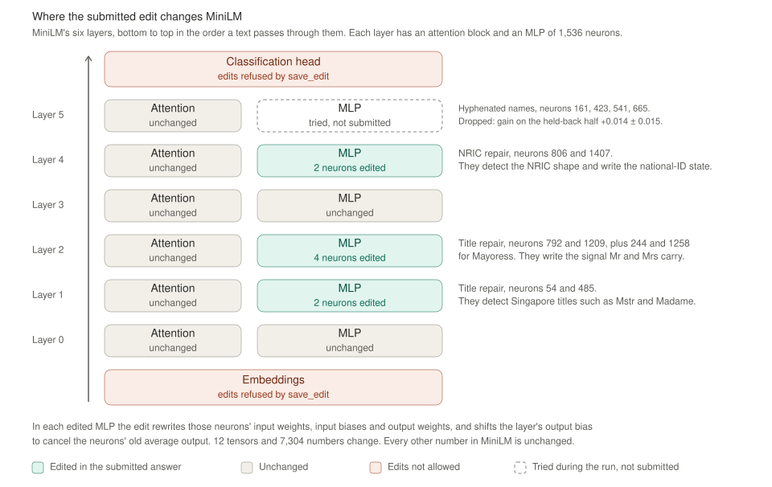

# M6 report: the editor run

M6 runs the 50-pass session once, with every setting M5 locked. Opus 5.5 spent 232 turns and all 50 forward passes on MiniLM. It submitted an edit that changes 12 tensors in the MLPs of layers 1, 2 and 4, with a final answer that describes two repairs, one for Singapore titles and one for NRICs. This report covers how the run went, what Opus 5.5 submitted, and the checks on the submitted edit. It does not score the edit on the hidden sets. M7 does that. It follows §2 and §7 of [weight-space-pii-handoff.md](weight-space-pii-handoff.md), with the decisions in the M2 to M5 reports.

Status: the run finished on 2026-11-06 and this report is written. Waiting for Desmond to review the items under "Show me". Committed on `main`, where `git log` lists every M6 commit.

## What you need to know first

The brief and five earlier reports hold the background. This section restates what M6 depends on. Each step builds on the one before it.

1. **Two AI models take part.** MiniLM (`MiniLM-L6-finetuned-pii-detection`) is the small model being edited. It tags each word of a text as a type of personal information, such as `first_name` or `national_id`, or as nothing. Opus 5.5 does the editing. The brief calls Opus 5.5 "the editor". It reads MiniLM's weights, the numbers inside MiniLM, and changes some of them by hand. Nothing is trained.
2. **The question is whether direct weight edits help.** MiniLM learned from American data and makes mistakes on Singapore text. The paper this experiment copies found that weight edits can remove an obstacle that hides an ability a model already has, but cannot add a missing one. This experiment asks whether the same holds for MiniLM.
3. **Opus 5.5 works through a harness, the code that runs its session.** Each reply holds one ` ```python ` block, which runs in a walled-off Python kernel, or one ` ```forward ` block, which runs MiniLM on request. A forward pass is one run of MiniLM over some texts, and the budget is 50. The final reply holds no block and explains the edit. M4 built the harness.
4. **Opus 5.5 sees only the practice set.** The practice set is 1,000 Singapore rows with their answers. Two hidden sets measure the result in M7. The main eval is 5,004 Singapore rows. The regression check is 18,515 rows like MiniLM's training data, and it shows whether the edit broke anything.
5. **M5 froze everything that decides a score.** `lock.json` holds a hash of every file that affects a score and the run's exact settings, such as the `claude` command, its version and the limits. `scripts/run_editor.py` refuses to start the run `p50` if anything differs. M5 also committed a prediction of what the edit would do, before the run, in [docs/m5_prediction.md](m5_prediction.md).
6. **Two parts of the paper's workflow are still unbuilt.** The paper restarted its conversation every 40 turns, and it sent back any code block that came without a plain-English explanation. The brief says to build the restart only if a run fills the context. Without a restart, the CLI compacts (shortens) a conversation that reaches 967,000 tokens.
7. **M6's job is to run the session once and keep what it produces.** The run folder `runs/p50/` holds the transcript, every forward pass, Opus 5.5's notes, the final answer and the submitted edit. M6 checks that the edit rebuilds exactly and shows the final answer and the edit manifest.


The first figure shows how the run spent its budget. Read the top three lanes from left to right. Each mark is a forward pass at the turn that asked for it. Opus 5.5 split the practice set into two halves of 500 rows on its own. It built and tuned its edits on the dev half and tested them on the held-back half. The third lane is texts Opus 5.5 wrote itself, such as US-style texts to check for damage and NRICs in new sentences. The dotted lines mark the first tested edit at turn 43, the first test of the final edit at turn 208, and the final answer at turn 232. The lower chart is the context, the conversation Opus 5.5 rereads each turn. It grew to 780,000 tokens and stayed under the red line where the CLI would have compacted it.



The second figure shows where the submitted edit sits inside MiniLM. A text passes from the embeddings at the bottom, up through layers 0 to 5, to the classification head at the top. Green MLPs hold the edit. The note beside each one names the neurons it changes and the repair they belong to. The dashed box in layer 5 is a repair Opus 5.5 tried and did not submit. Every attention block is unchanged. [docs/figures/report_figures.py](figures/report_figures.py) generates both figures.

## Decisions

| Item | Brief | Decision and reason |
|---|---|---|
| The restart | §2 step 5 builds it only if a run fills the context | Not built. On 2026-11-06, I recommended running without it, as the brief says, and Desmond started M6. M5 estimated about 158 turns and 744,000 tokens. The run took 232 turns but reached only 780,000 tokens, so the CLI never compacted and the restart was never needed |
| The prediction in the run folder | §4 puts it in the run folder | The driver refuses to start a run whose folder exists, so M5 committed the prediction in `docs/`. I copied it into `runs/p50/m5_prediction.md` less than a minute after the run started. Its SHA-256 matches the committed file, `2a8d50bf…` |
| How the run was launched | Not specified | Under `caffeinate -i`, so the Mac could not sleep during the run. The driver's own output went to `runs/p50_launch.log` |

## The run started from the locked state

I checked these before the launch at 19:19 on 2026-11-06, and `run_editor.py` checked them again:

- The git tree was clean at commit `db4aaed`, and `run.json` records that commit with `"dirty": false`.
- `claude --version` gave 2.1.318, the version `lock.json` records.
- `wsp.lock.check()` passed, and `run.json` records the hash of `lock.json`, `e26da9fd…`.
- `run_editor.py` compared the run's settings with the locked ones and the rendered prompt with [docs/m5_task_prompt.txt](m5_task_prompt.txt). Both matched, or it would have refused.
- The copy of MiniLM in the walled-off area has the same SHA-256 as the locked `data/model/model.safetensors`, `25cac79d…`.
- Every reply in the CLI's own log for the run records `"model":"claude-opus-5-5"` and `"effort":"max"`.

## The run in numbers

The run ended with the final answer at turn 232, after 1 hour and 43 minutes. Every number below comes from `runs/p50/run.json` or the transcript.

| Measure | Run | M5 estimate at 232 turns |
|---|---|---|
| Turns | 232 | 158 for a run as long as the paper's |
| Forward passes | 50 of 50 | 50 |
| Code runs | 180 of 300 | |
| Replies sent back as invalid | 1. Turn 4 held two code blocks, and the driver ran neither | |
| Failed forward passes, kernel restarts, CLI retries | 0, 0, 0 | |
| Context at the end | 780,063 tokens | 1,092,000 tokens |
| Context added per turn | 3,360 tokens | 4,700 tokens |
| Output per turn | 2,516 tokens | 3,766 tokens |
| Seconds per reply | 26.2 | 40 |
| Cost at API prices | $36.42 | $51.58 |
| Wall time | 1.7 hours | 2.7 hours |
| Compacted | No | |

The run took 74 more turns than the paper's `p50c`, but each turn was shorter than in dry run 3, the run the estimate is based on. So the context, the cost and the wall time all came in under the estimate for 232 turns. The run uses the claude.ai subscription, so the dollars measure how much of the usage allowance it took, not a charge. The estimate's numbers at 232 turns come from the model in `scripts/estimate_cost.py` and the values in `runs/base/estimate.json`.

## How Opus 5.5 spent its 50 passes

The transcript and `work_notes/notes.md` show five stretches of work. The turn of each forward pass comes from `transcript.jsonl`. Its items, and which half they belong to, come from `forward/<k>/request.json` and `work_notes/split.json`.

1. **Turns 1 to 42 read the data and the unedited MiniLM.** Opus 5.5 split the practice set into a dev half and a held-back half of 500 rows each, with no row in both. Passes 1 to 3 measured the unedited MiniLM on the dev half and on 64 texts it wrote.
2. **Turns 43 to 120 built the repairs on the dev half.** Pass 4 tested the first edit, 3 tensors in layer 4 for the NRIC repair. By pass 14, the edit held three repairs in 12 tensors. The title repair was in layers 1 and 2, the NRIC repair in layer 4, and a repair for hyphenated names in layer 5.
3. **Turn 121 tested on the held-back half for the first time.** Pass 15 scored F1 0.856 for the unedited MiniLM and 0.922 for the three-repair edit.
4. **Turns 122 to 207 checked for damage and took the edit apart.** Passes on its own texts checked US-style texts and NRIC look-alikes. From pass 19, each repair also shifted its layer's output bias, which brought the edit to 16 tensors. Passes 23 to 25 scored each repair alone on the held-back half. The hyphenated-name repair added +0.014 ± 0.015 there, and Opus 5.5 dropped it. A repair for names that act as chat speaker labels was tried and dropped too.
5. **Turns 208 to 232 confirmed the final edit.** Pass 40 first tested the final edit. Passes 40, 47 and 50 each scored it at F1 0.921 on the held-back half, and their edit manifests match the submitted one. Then Opus 5.5 wrote the final answer.

## What Opus 5.5 submitted

[runs/p50/final_answer.md](../runs/p50/final_answer.md) holds the full answer. In short, Opus 5.5 reports two repairs. Each repair takes 2 or 4 MLP neurons that were almost never active and reuses them as a detector.

- **Singapore titles, in layers 1 and 2.** MiniLM tags Mr and Mrs as nothing, but it tagged Singapore titles such as Mayoress, Mstr, Miss and Madame as `first_name`. After "Master", it read the following name as a company. Opus 5.5 found that Mr and Mrs carry a feature that tells the last layer to output nothing, and that the Singapore titles lack it. Neurons 54 and 485 in layer 1 and neurons 792 and 1209 in layer 2 detect the titles and write that feature. Neurons 244 and 1258 in layer 2 do the same for Mayoress. On the held-back half, Opus 5.5 reports `name` F1 rising from 0.865 to 0.918.
- **NRICs, in layer 4.** MiniLM typed an ID number only from nearby words. Next to "tax" it got 84% of NRICs right, and with no such word it got 0 of 27. Opus 5.5 found that the NRIC's shape is readable at the input of layer 4's MLP. Neurons 806 and 1407 detect the shape and write the state MiniLM uses for a national ID. On the held-back half, Opus 5.5 reports `national_id` F1 rising from 0.747 to 0.956.

For each repair, Opus 5.5 reports a test that the feature it writes is one MiniLM uses. Subtracting the title feature from "Mrs" made MiniLM tag "Mrs" as a name in 3 of 3 test sentences. Subtracting the NRIC state removed the label from 14 of 31 NRICs that have a cue word nearby. Opus 5.5 also lists what it could not fix: NRICs next to another ID type's cue, the title "Mdm", which never appears in the practice set, and about 8% of codes shaped like a letter and 7 digits that still change label.

## The edit rebuilds exactly

`runs/p50/edit/manifest.json` lists 12 tensors and 7,304 changed numbers. The edit stores only the changed numbers, in `runs/p50/edit/edit.npz`.

| Layer | Tensors | Neurons | Numbers changed |
|---|---|---|---|
| 1 | MLP input weight and bias, output weight and bias | 54, 485 | 1,922 |
| 2 | MLP input weight and bias, output weight and bias | 244, 792, 1209, 1258 | 3,460 |
| 4 | MLP input weight and bias, output weight and bias | 806, 1407 | 1,922 |

In each edited MLP, the edit rewrites the chosen neurons' rows of the input weight, their input biases and their columns of the output weight. It also changes all 384 entries of the layer's output bias, which is Opus 5.5's correction for the neurons' old average output. No edit multiplies a whole tensor by one number, and the server checked every edit against the rules before each pass.

I rebuilt the 12 edited tensors from `edit.npz` and the original weights with `wsp.harness.edit.apply_npz`. Every rebuilt tensor matches `sha256_edited` in the manifest, and every original matches `sha256_original`. The manifests that passes 40, 47 and 50 record list the same 12 tensors with the same hashes.

## Opus 5.5's held-back score is not a clean test

Opus 5.5 calls its 0.856 to 0.921 result held-out, and writes that the held-back half was "never used to design anything". The run shows otherwise. Ten passes scored edits on the held-back half. Passes 23 to 25 scored each repair alone there, and Opus 5.5 dropped the hyphenated-name repair because its gain there was within one standard error. So the held-back half helped choose the submitted edit, and 0.921 is likely to be a little high. This breaks no rule. The practice set is Opus 5.5's to use however it likes. The clean test is the main eval, which Opus 5.5 never saw, and M7 scores it.

## The final answer and the M5 prediction disagree

The M5 prediction says the edit fixes NRICs without "tax" just before them and leaves every name category unchanged. It expects overall Singapore F1 on the main eval to rise by 0.002 to 0.009. The final answer agrees on NRICs but also claims a large gain on names. On the held-back half, it reports overall F1 rising by 0.065. The prediction counts only the share of entities MiniLM gets right. Most of the title repair removes false positives, where MiniLM tagged a title as a name, so it raises precision, and the prediction did not account for that. Which claim holds on the main eval is M7's question. This report does not score the edit.

## Show me

- The final answer: [runs/p50/final_answer.md](../runs/p50/final_answer.md).
- The edit manifest: [runs/p50/edit/manifest.json](../runs/p50/edit/manifest.json), summarized in the table under "The edit rebuilds exactly".

`runs/` is not in git, so both links work only on this machine.

## Reproduce M6

Run these commands from the repository root. The run itself cannot be repeated exactly, because Opus 5.5 answers differently each time.

1. Start the run. It refuses unless the tree is clean, `claude --version` matches `lock.json`, and `runs/p50/` does not exist. This run used $36.42 of the subscription at API prices.

	```bash
	caffeinate -i uv run python -I scripts/run_editor.py --name p50 --budget 50 > runs/p50_launch.log 2>&1
	```

2. After the run folder exists, copy the prediction into it.

	```bash
	cp docs/m5_prediction.md runs/p50/m5_prediction.md
	```

3. Rebuild the edit and compare it with the manifest.

	```bash
	uv run python -I -c "import json, pathlib; from safetensors.numpy import load_file; from wsp.harness.edit import apply_npz, sha256; m = json.load(open('runs/p50/edit/manifest.json')); o = pathlib.Path('data/model/model.safetensors'); r = apply_npz(pathlib.Path('runs/p50/edit/edit.npz'), o); w = load_file(o); print([t['name'] for t in m['tensors'] if sha256(r[t['name']]) != t['sha256_edited'] or sha256(w[t['name']].astype('float32')) != t['sha256_original']] or 'all 12 match')"
	```

4. Regenerate the figures.

	```bash
	uv run python -I docs/figures/report_figures.py
	```

## Open items

- **`runs/p50/` exists only on this disk.** Git does not track `runs/`, and M7, M8 and any later review depend on this folder. It should be backed up before anything else touches it.
- **M7 should treat Opus 5.5's held-back numbers as tuned.** Only the main eval and the regression check measure the edit cleanly.
- **The M7 checks from the M5 report are still open.** M7's scoring must call `wsp.lock.check`, compare `run.json` with the locked settings, pair Nemotron rows by position, and compare the harness code between the commit of the seventh freeze and `db4aaed`, the commit the run started from.
- **M7 should still rebuild every forward pass's edit.** I compared only the manifests of passes 40, 47 and 50 with the submitted edit, not the `edit.npz` files of all 50 passes.
- **The restart and the check for unexplained code blocks are still unbuilt.** Neither affected this run's limits. The run never neared compaction, and the prompt asks for an explanation before every block, but no code enforces it.
- **`data/sets.json` still lists `first_name` and `last_name` as scored labels, and [docs/m3_review.md](m3_review.md) predates the merge.** Both are unchanged from the M5 report.
